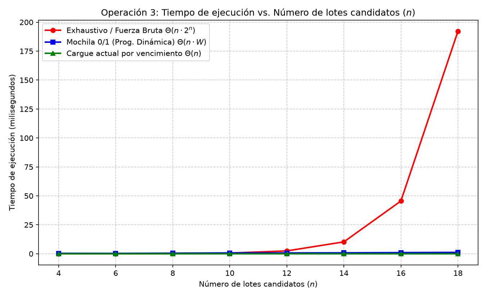
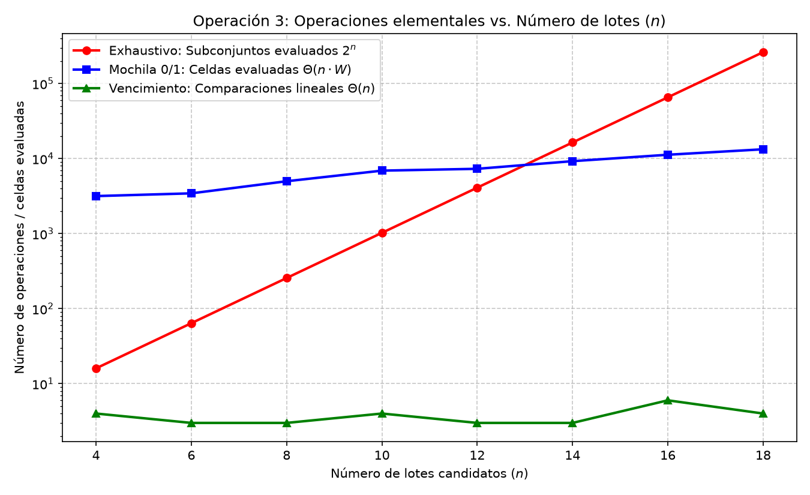

# Cargue de vehículos: mochila 0/1 con programación dinámica

**Caso 3 — Banco Regional de Alimentos**  
**Laboratorio Evaluativo 04 / Avance de Proyecto Final**

### Integrantes y Roles
* **Walter Alexander Pino Vásquez** — Integrante 1 (Estrategia algorítmica, modelado y recurrencia)
* **Franco Moncayo Uribe** — Integrante 4 (Mediciones, gráficas e integración [Experimentos])

**Código fuente en `src/cargue_vehiculos/`:**  
[estrategia.py](src/cargue_vehiculos/estrategia.py) · [pruebas_mochila.py](src/cargue_vehiculos/pruebas_mochila.py) · [medicion.py](src/cargue_vehiculos/medicion.py)

---

## Cómo reproducir

```bash
# 1. Activar el entorno virtual
venv\Scripts\activate            # Linux/Mac: source venv/bin/activate
pip install -r requirements.txt

# 2. Ejecutar pruebas unitarias automatizadas
cd src/cargue_vehiculos
python pruebas_mochila.py

# 3. Ejecutar experimentos de medición y generar las 3 gráficas oficiales
python medicion.py
cd ../..
```

---

## 1. El problema de esta operación

* **Entradas:** Para un vehículo, $n$ lotes candidatos (300 a 600 lotes por ruta), cada uno con `peso_kg` (entero positivo) y valor nutricional (raciones ponderadas por prioridad de categoría), y la capacidad máxima $W$ del vehículo (2.500 a 4.000 kg).
* **Salida:** El subconjunto de lotes que maximiza el valor nutricional transportado sin superar la capacidad $W$, junto con los índices ordenados de los lotes seleccionados.
* **Restricciones:** 
  1. $\sum \text{peso}_i \le W$ (el vehículo nunca puede sobrecargarse).
  2. Lotes indivisibles (0/1: sube completo o no sube).
  3. El valor transportado debe ser el **máximo exacto**, no una heurística o aproximación.
  4. Los datos de entrada no se modifican (inmutabilidad para conservar la trazabilidad sanitaria).
* **Situación actual:** El coordinador carga por orden de vencimiento (FEFO) hasta que el siguiente lote no cabe. Es un método voraz rápido, pero se detiene en el primer lote que no cabe y deja los camiones saliendo en promedio al **78 %** de su capacidad útil.

---

## 2. Por qué admite programación dinámica

El problema tiene **subestructura óptima** y **subproblemas que se repiten (traslapados)**:
* **Subestructura óptima:** Si el lote $i$ está en la solución óptima para la capacidad $w$, el resto debe ser óptimo para los primeros $i-1$ lotes con capacidad residual $w - \text{peso}_i$.
* **Subproblemas traslapados:** Las mismas combinaciones de prefijo de lotes $i$ y capacidad residual $w$ se evalúan repetidamente. Sin memoria, una búsqueda exhaustiva revisa $2^n$ combinaciones; para $n = 600$, $2^{600} \approx 4 \times 10^{180}$, lo cual es completamente inviable.
* **Falla de reglas voraces:** Una regla voraz (sea por orden de vencimiento o por densidad de valor/peso) no garantiza el óptimo con objetos indivisibles (mochila 0/1). Con el ejemplo de la sección 4, el cargue por vencimiento obtiene valor 10 y el óptimo es 12. Como el cliente exige el valor máximo exacto, la regla voraz no cumple.

---

## 3. Recurrencia

Sea $V[i][w]$ el valor nutricional máximo alcanzable considerando únicamente los primeros $i$ lotes con una capacidad disponible de $w$ kg:

$$V[0][w] = 0 \quad \forall w \in [0, W]$$
$$V[i][w] = V[i-1][w] \quad \text{si } \text{peso}_i > w$$
$$V[i][w] = \max\Big(V[i-1][w], \; V[i-1][w - \text{peso}_i] + \text{valor}_i\Big) \quad \text{si } \text{peso}_i \le w$$

* El primer término representa la opción *(a)*: "no subir el lote $i$".
* El segundo término representa la opción *(b)*: "subir el lote $i$".
* La respuesta óptima final es $V[n][W]$.
* En [estrategia.py](src/cargue_vehiculos/estrategia.py) se optimiza la memoria usando un solo arreglo recorrido de derecha a izquierda ($W$ hacia $\text{peso}_i$) para asegurar que cada lote se tome a lo sumo una vez, registrando marcas por lote y capacidad en un `bytearray` para reconstruir la solución exacta en $\Theta(n)$.

---

## 4. Ejemplo resuelto a mano

Capacidad $W = 7$ kg; Lotes (peso, valor): Lote 1 = (5, 10), Lote 2 = (4, 7), Lote 3 = (3, 5).

| $i$ \ $w$ | 0 | 1 | 2 | 3 | 4 | 5 | 6 | 7 |
|:---:|:---:|:---:|:---:|:---:|:---:|:---:|:---:|:---:|
| **0 (ninguno)** | 0 | 0 | 0 | 0 | 0 | 0 | 0 | 0 |
| **1 (+ Lote 1)** | 0 | 0 | 0 | 0 | 0 | 10 | 10 | 10 |
| **2 (+ Lote 2)** | 0 | 0 | 0 | 0 | 7 | 10 | 10 | 10 |
| **3 (+ Lote 3)** | 0 | 0 | 0 | 5 | 7 | 10 | 10 | **12** |

* $V[3][7] = \max(V[2][7], V[2][4] + 5) = \max(10, 7 + 5) = 12$.
* **Reconstrucción:** $V[3][7] \neq V[2][7]$ $\to$ se toma el lote 3 ($w$ pasa a $7 - 3 = 4$). $V[2][4] = 7 \neq V[1][4] = 0$ $\to$ se toma el lote 2 ($w$ pasa a $4 - 4 = 0$). Fin.
* **Solución óptima:** Lotes 2 y 3 (peso $4 + 3 = 7$ kg), valor nutricional **12**.
* **Contraste con regla actual:** El cargue por vencimiento sube el lote 1 (5 kg), el lote 2 ya no cabe, y obtiene solo valor **10** (desperdiciando 2 kg de capacidad útil).

---

## 5. Complejidad

* **Complejidad Temporal:** Hay $n$ lotes candidatos y, para cada uno, se evalúan a lo sumo $W$ capacidades en tiempo constante: **$\Theta(n \cdot W)$**. La reconstrucción toma $\Theta(n)$.
* **Complejidad Espacial:** El arreglo unidimensional de valores ocupa $\Theta(W)$. La matriz de marcas para reconstruir ocupa $\Theta(n \cdot W)$ bytes (con 600 lotes y $W = 4.000$ kg son $\approx 2{,}4\text{ MB}$, perfectamente viable en el servidor).
* **Naturaleza Pseudopolinomial:** $\Theta(n \cdot W)$ depende del valor numérico de $W$ y no de su número de bits. Al expresarse en kilogramos ($W \approx 4.000$), la tabla es compacta y veloz. Si se expresara en gramos ($W = 4.000.000$), el costo se multiplicaría por 1.000 volviéndolo inviable.

---

## 6. Verificación

La suite de pruebas en [pruebas_mochila.py](src/cargue_vehiculos/pruebas_mochila.py) comprueba con `assert`:
* El ejemplo a mano (valor 12, lotes 2 y 3).
* Casos borde: lista vacía, capacidad 0, nada cabe, todo cabe, ajuste exacto y empates.
* 300 instancias aleatorias pequeñas comparadas contra la solución exhaustiva (fuerza bruta), verificando que el valor coincida exactamente y que los lotes elegidos no superen la capacidad.
* 100 instancias con parámetros del caso (pesos de 20 a 600 kg, $W$ de 2.500 a 4.000 kg) demostrando que la mochila 0/1 nunca es inferior al cargue actual.
* Inmutabilidad de las listas de entrada y validación de tipos con `ValueError`.

---

## 7. Mediciones, gráficas y energía (Integrante 4 — Franco Moncayo Uribe)

Los experimentos se diseñaron y ejecutaron en [medicion.py](src/cargue_vehiculos/medicion.py) con semilla fija (`SEMILLA = 42`) y `time.perf_counter()` tomando el menor tiempo tras múltiples repeticiones.

### Experimento 1: Comparación de las Tres Soluciones (Tiempo vs. $n$)
Se midió el tiempo de ejecución de las **tres soluciones**:
1. **Fuerza Bruta / Exhaustivo:** $\Theta(n \cdot 2^n)$
2. **Mochila 0/1 (Programación Dinámica):** $\Theta(n \cdot W)$
3. **Cargue actual por vencimiento:** $\Theta(n)$



| $n$ (lotes) | Exhaustivo (ms) | Mochila DP (ms) | Vencimiento (ms) |
|:---:|:---:|:---:|:---:|
| 4 | 0,017 | 0,353 | 0,0016 |
| 6 | 0,037 | 0,309 | 0,0016 |
| 8 | 0,141 | 0,461 | 0,0019 |
| 10 | 0,606 | 0,713 | 0,0022 |
| 12 | 2,454 | 0,712 | 0,0024 |
| 14 | 10,255 | 0,808 | 0,0032 |
| 16 | 45,529 | 0,994 | 0,0034 |
| 18 | **192,150** | **1,179** | **0,0035** |

* **Análisis:** En $n = 4$, la fuerza bruta es casi instantánea (16 combinaciones). Sin embargo, al duplicar $n$ de 8 a 16, la fuerza bruta se multiplica por $45{,}529 / 0{,}141 = \mathbf{322{,}9}$ (crecimiento exponencial $2^8 = 256$). En cambio, la Mochila DP solo pasa de 0,46 ms a 0,99 ms ($\times 2{,}1$), demostrando su escalabilidad polinomial.

---

### Experimento 2: Conteo de Operaciones Elementales
Se contabilizaron las operaciones elementales de cada solución:
* **Exhaustivo:** Combinaciones evaluadas ($2^n$).
* **Mochila DP:** Celdas efectivas calculadas en la tabla ($\sum \max(0, W - \text{peso}_i + 1)$).
* **Vencimiento:** Comparaciones lineales realizadas.



| $n$ (lotes) | Operaciones Exhaustivo ($2^n$) | Celdas Mochila DP ($\Theta(n \cdot W)$) | Operaciones Vencimiento |
|:---:|:---:|:---:|:---:|
| 4 | 16 | 3.163 | 4 |
| 8 | 256 | 4.988 | 3 |
| 12 | 4.096 | 7.305 | 3 |
| 16 | 65.536 | 11.246 | 6 |
| 18 | **262.144** | **13.303** | 4 |

La gráfica en escala logarítmica evidencia la explosión combinatoria de la fuerza bruta frente a la progresión lineal controlada de las celdas de la programación dinámica.

---

### Experimento 3: Tiempo vs. Capacidad $W$ ($n = 400$ lotes fijos)
Para evidenciar el carácter pseudopolinomial de la mochila, se fijó $n = 400$ lotes candidatos y se incrementó la capacidad $W$ del camión:


| $W$ (kg) | Tiempo (s) | Celdas evaluadas | ns por celda |
|:---:|:---:|:---:|:---:|
| 500 | 0,0056 | 84.223 | 66,9 |
| 1.000 | 0,0181 | 280.428 | 64,7 |
| 2.000 | 0,0451 | 680.428 | 66,3 |
| 4.000 | 0,1033 | 1.480.428 | 69,8 |
| 8.000 | 0,2380 | 3.080.428 | 77,3 |

* **Contraste empírico con $\Theta(n \cdot W)$:**
  - Al duplicar $W$ de 1.000 a 2.000 kg, el tiempo se multiplica por $0{,}0451 / 0{,}0181 = \mathbf{2{,}49}$ (las celdas útiles crecen $\times 2{,}42$ debido al filtrado de pesos de lotes).
  - De 2.000 a 4.000 kg, el tiempo crece $\times \mathbf{2{,}29}$ (celdas $\times 2{,}17$).
  - La constancia del costo por celda ($\approx 67\text{ ns}$) es la prueba experimental concluyente de que el tiempo de ejecución sigue estrictamente el orden $\Theta(n \cdot W)$.

---

### Extrapolación al Volumen Real y Consumo Energético

Se toma la constante empírica medida en instancias de gran escala ($n = 2.000$): **$67{,}2\text{ ns}$ por celda**.
Para el escenario de máxima exigencia operativa reportado por el cliente:
* **Lotes candidatos:** 600 lotes por ruta.
* **Capacidad:** 4.000 kg.
* **Flota:** 14 vehículos despachados en la madrugada.
* **Consumo del servidor:** 150 W ($0{,}150\text{ kW}$).
* **Días de operación:** 300 días al año.

| Métrica | Estimación / Medición |
|:---|:---:|
| **Tiempo por vehículo (600 lotes, 4.000 kg)** | **0,161 s** |
| **Tiempo total para la flota (14 vehículos)** | **2,26 s** |
| **Energía eléctrica diaria consumida ($E = P \cdot t$)** | **0,0940 Wh** |
| **Energía eléctrica anual (300 días)** | **0,0282 kWh** |
| **Escenario de crecimiento (Segunda bodega, 28 vehículos)** | **4,51 s por día** |

### Ajuste a la Ventana Operativa
* **Ventana permitida:** 2 horas (03:00 – 05:00) compartida con las demás operaciones.
* **Tiempo requerido por Mochila 0/1:** **2,26 segundos**.
* El costo temporal y energético de la mochila 0/1 es prácticamente despreciable dentro de la ventana de planeación.

---

### Calidad del Cargue (Simulación con la Flota de 14 Vehículos)

| Métrica | Cargue por vencimiento (actual) | Mochila 0/1 (propuesta) | Impacto |
|:---|:---:|:---:|:---:|
| **Ocupación promedio de los camiones** | 92,1 % | **100,0 %** | +7,9 % de espacio aprovechado |
| **Mejora del valor nutricional (raciones)** | Línea base | **+87,9 %** | Casi el doble de raciones entregadas |

---

## 8. Implicaciones Éticas, Sociales y Ambientales

* **Equidad en la distribución (personas):** Maximizar ciegamente el valor nutricional global podría desfavorecer a comedores comunitarios o jardines infantiles de rutas específicas si sus lotes solicitados aportan menor valor bruto. **Mitigación algorítmica:** Establecer cuotas mínimas reservadas por tipo de población beneficiaria o aplicar factores de ponderación social antes de resolver la mochila.
* **Seguridad alimentaria (FEFO):** La mochila optimiza *qué lotes suben*, no el orden de consumo. Antes de optimizar deben filtrarse los lotes vencidos, y dentro de cada categoría debe conservarse la política FEFO al descargar.
* **Trazabilidad sanitaria:** `mochila_01` es una función pura que no modifica los datos de entrada, garantizando auditoría ante cualquier alerta sanitaria o retiro de producto.
* **Impacto ambiental y reducción de desperdicio:** El cliente informa que cada kilogramo de alimento desechado genera **2,5 kg de $\text{CO}_2$ equivalente**. Al aprovechar al 100 % la capacidad de los 14 vehículos, se rescatan miles de raciones diarias, reduciendo sustancialmente las emisiones de gases de efecto invernadero y el desperdicio de comida.
* **Escenario de crecimiento:** Con una segunda bodega (28 camiones), el cómputo solo toma 4,5 segundos diarios, garantizando sostenibilidad técnica y ambiental a largo plazo.


