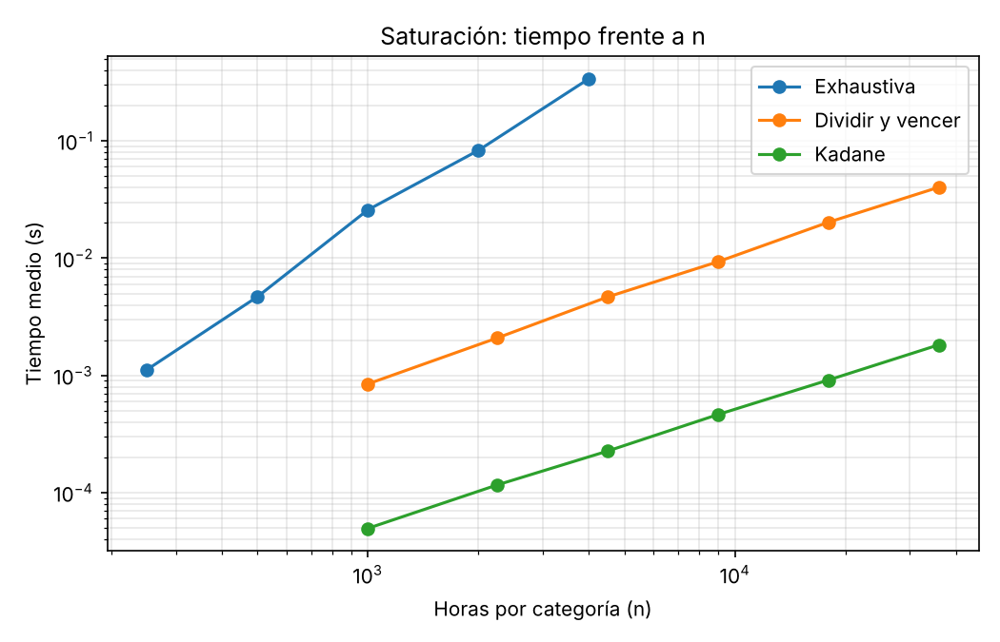

# Planeación de despachos y saturación de bodega

**Caso 3 — Banco Regional de Alimentos**  
**Proyecto final — Análisis de Algoritmos — 23 de noviembre de 2026**

**Integrantes y roles**

* **Walter Alexander Pino Vásquez** — Estrategia algorítmica, modelado y recurrencia.
* **Ana María Colorado Varela** — Soluciones exhaustivas, reglas de cargue, contraejemplos e integración del informe.
* **Juan David Machado Mosquera** — Datos, pruebas y validación.
* **Franco Moncayo Uribe** — Mediciones y gráficas de saturación; línea base energética (§4.5); comparación integral (§5.6), extrapolación y escenario de crecimiento.

**Código fuente en `src/cargue_vehiculos/`:**  
[estrategia.py](src/cargue_vehiculos/estrategia.py) · [pruebas_mochila.py](src/cargue_vehiculos/pruebas_mochila.py) · [medicion.py](src/cargue_vehiculos/medicion.py) · [exhaustivo.py](src/cargue_vehiculos/exhaustivo.py) · [regla_actual.py](src/cargue_vehiculos/regla_actual.py) · [pruebas_contraejemplos.py](src/cargue_vehiculos/pruebas_contraejemplos.py) · [datos.py](src/cargue_vehiculos/datos.py) · [pruebas.py](src/cargue_vehiculos/pruebas.py)

**Código fuente de la operación 4 en `src/saturacion_bodega/`:**  
[estrategia.py](src/saturacion_bodega/estrategia.py) · [medicion.py](src/saturacion_bodega/medicion.py) · [datos.py](src/saturacion_bodega/datos.py) · [pruebas.py](src/saturacion_bodega/pruebas.py) · [exhaustivo.py](src/saturacion_bodega/exhaustivo.py)

El Laboratorio 4 del 18 de noviembre de 2026 aborda la operación 3: cargue de vehículos. El informe se completa para la entrega del 23 de noviembre con las dos operaciones implementadas (cargue y saturación), la línea base energética, la comparación integral y las conclusiones.

**Preparación del entorno**

Desde la raíz del repositorio, en WSL Ubuntu:

```bash
# Crear el entorno virtual la primera vez
python3 -m venv .venvAnalisis

# Activar el entorno
source .venvAnalisis/bin/activate

# Instalar las dependencias
python -m pip install -r requirements.txt
```

Si el entorno ya existe, basta con activarlo. Los comandos para ejecutar las pruebas y las mediciones están en el [apartado 8](#8-instrucciones-de-reproducción).

---

## 1. Análisis del problema

### 1.1. Operación 3: cargue de vehículos

* **Entradas:** Para un vehículo, $n$ lotes candidatos (300 a 600 lotes por ruta), cada uno con `peso_kg` (entero positivo) y valor nutricional (raciones ponderadas por prioridad de categoría), y la capacidad máxima $W$ del vehículo (2.500 a 4.000 kg).
* **Salida:** El subconjunto de lotes que maximiza el valor nutricional transportado sin superar la capacidad $W$, junto con los índices ordenados de los lotes seleccionados.
* **Restricciones:**

  1. $\sum \text{peso}_i \le W$ (el vehículo nunca puede sobrecargarse).
  2. Lotes indivisibles (0/1: sube completo o no sube).
  3. El valor transportado debe ser el **máximo exacto**, no una heurística o aproximación.
  4. Los datos de entrada no se modifican (inmutabilidad para conservar la trazabilidad sanitaria).
* **Situación actual, según el caso de estudio:** El coordinador carga por orden de vencimiento (FEFO) hasta que el siguiente lote no cabe. Es un método voraz rápido, pero se detiene en el primer lote que no cabe y deja los camiones saliendo en promedio al **78 %** de su capacidad útil.

**Supuestos de esta operación:** se usan pesos enteros positivos en kg,
valores nutricionales no negativos y candidatos previamente filtrados como
aptos. Un lote que vence el día del despacho se admite; los vencidos se
excluyen con `filtrar_aptos`. Los pesos sintéticos (20–600 kg), las raciones
(2–4 por kg) y las prioridades (3, 2 y 1) son supuestos del equipo, detallados
en §3.2.1. En empates de vencimiento o densidad se conserva el orden original.
La ocupación mide peso/capacidad y no sustituye el objetivo nutricional.
La selección 0/1 y el orden sanitario de despacho son pasos distintos: los
lotes elegidos deben salir por vencimiento dentro de cada categoría. El
ordenamiento de bodega corresponde a la operación 2.

### 1.2. Análisis de las cuatro operaciones del banco

El proceso atiende a 420 organizaciones beneficiarias y mantiene cerca de
220.000 lotes activos, con 6.000 a 9.000 incorporaciones diarias. Se analizan
las cuatro operaciones y se seleccionan **cargue y saturación** para la
implementación experimental: la primera exige una selección óptima con
capacidad limitada y la segunda permite contrastar algoritmos exactos con
distintos órdenes de crecimiento.

| Operación | Entradas y salida | Proceso actual y costo | Alternativa y alcance |
|---|---|---|---|
| 1. Consulta de inventario | Lotes y código o rango de vencimiento; devuelve un lote o los que vencen en el rango. | Recorre la lista completa: $\Theta(N)$ por consulta. Las 30.000 consultas por código representan aproximadamente 6.600 millones de inspecciones diarias con $N=220.000$, sin contar las consultas por rango. | Índice hash por código: $O(1)$ esperado por consulta; índice ordenado por fecha: $O(\log N+k)$ por rango, con $k$ resultados. Ambos requieren $O(N)$ de almacenamiento adicional y mantenimiento. Propuesta de diseño, sin implementación ni tiempos medidos. |
| 2. Ordenamiento FEFO | Lista previamente ordenada y nuevos lotes anexados; devuelve el orden por vencimiento y, en empate, categoría. | Inserción: $O((N+m)^2)$ en general. Al aprovechar el prefijo ya ordenado, el peor caso es $O(Nm+m^2+N)$ para $m$ incorporaciones, por los desplazamientos de los lotes nuevos. | Ordenar las incorporaciones y fusionarlas con el inventario: $O(m\log m+N+m)$ temporal y $O(N+m)$ auxiliar, sobre referencias para conservar los registros originales. Propuesta sin implementación experimental. |
| 3. Cargue de vehículos | 300–600 candidatos por ruta y capacidad de 2.500–4.000 kg; devuelve lotes completos de valor nutricional máximo. | Vencimiento: ordena y se detiene en el primer lote que no cabe. Es rápido, pero no garantiza el óptimo; el 78 % de ocupación informado por el banco es una medida de peso, no de valor nutricional. | Programación dinámica, contrastada con exhaustiva y las dos reglas. El diseño, las pruebas y las mediciones se desarrollan en los apartados siguientes. |
| 4. Saturación de bodega | Cambios netos horarios en kg por categoría; devuelve suma máxima e índices de un tramo consecutivo no vacío. | Examina todos los tramos: $n(n+1)/2$. Con sumas incrementales, $\Theta(n^2)$ temporal y $O(1)$ auxiliar. El cliente informa más de un día para procesar las 40 categorías. | Exhaustiva como referencia exacta; dividir y vencer y Kadane como alternativas implementadas en [estrategia.py](src/saturacion_bodega/estrategia.py). La comparación debe verificar igualdad de la suma óptima, aunque los índices puedan diferir en empates. |

En las dos primeras filas, $N$ es el inventario previo y $m$ las
incorporaciones. En saturación, $n=36.000$ horas por categoría implica
648.018.000 tramos y 25.920.720.000 para las 40 categorías. Estos conteos
explican el crecimiento del trabajo; no equivalen a tiempos medidos ni
demuestran cuánto tarda cada operación en el computador del banco.

Las consultas individuales deben responder en menos de un segundo. Las
consultas por rango, FEFO y cargue comparten la ventana de 03:00 a 05:00;
el proceso actual tarda cerca de 4,5 horas. El análisis histórico de
saturación es una tarea distinta y no tiene una frecuencia diaria
establecida. La línea base energética del proceso completo se desarrolla
en §4.5; mejorar el cargue por sí solo no demuestra que se cumplan las dos
horas de planeación.

Los datos se consideran válidos, caben en memoria y no cambian durante la
ejecución, que usa un único hilo. Deben conservarse los registros originales,
excluirse los vencidos y respetarse FEFO dentro de cada categoría. El tramo
de mayor crecimiento no determina por sí solo la capacidad absoluta del
cuarto frío: también hacen falta el inventario inicial y las condiciones
de almacenamiento de cada producto.

---

## 2. Diseño de la solución

### 2.1. Justificación de la programación dinámica

El problema tiene **subestructura óptima** y **subproblemas que se repiten (traslapados)**:

* **Subestructura óptima:** Si el lote $i$ está en la solución óptima para la capacidad $w$, el resto debe ser óptimo para los primeros $i-1$ lotes con capacidad residual $w - \text{peso}_i$.
* **Subproblemas traslapados:** Las mismas combinaciones de prefijo de lotes $i$ y capacidad residual $w$ se evalúan repetidamente. Sin memoria, una búsqueda exhaustiva revisa $2^n$ combinaciones; para $n = 600$, $2^{600} \approx 4 \times 10^{180}$, lo cual es completamente inviable.
* **Falla de reglas voraces:** Una regla voraz (sea por orden de vencimiento o por densidad de valor/peso) no garantiza el óptimo con objetos indivisibles (mochila 0/1). Con el ejemplo de la sección 2.3, el cargue por vencimiento obtiene valor 10 y el óptimo es 14. Como el cliente exige el valor máximo exacto, la regla voraz no cumple.

### 2.2. Recurrencia

Sea $V[i][w]$ el valor nutricional máximo alcanzable considerando únicamente los primeros $i$ lotes con una capacidad disponible de $w$ kg:

$$V[0][w] = 0 \quad \forall w \in [0, W]$$
$$V[i][w] = V[i-1][w] \quad \text{si } \text{peso}_i > w$$
$$V[i][w] = \max\Big(V[i-1][w], \; V[i-1][w - \text{peso}_i] + \text{valor}_i\Big) \quad \text{si } \text{peso}_i \le w$$

* El primer término representa la opción *(a)*: "no subir el lote $i$".
* El segundo término representa la opción *(b)*: "subir el lote $i$".
* La respuesta óptima final es $V[n][W]$.
* En [estrategia.py](src/cargue_vehiculos/estrategia.py) se optimiza la memoria usando un solo arreglo recorrido de derecha a izquierda ($W$ hacia $\text{peso}_i$) para asegurar que cada lote se tome a lo sumo una vez, registrando marcas por lote y capacidad en un `bytearray` para reconstruir la solución exacta en $\Theta(n)$.

### 2.3. Ejemplo resuelto a mano

Instancia reducida de cuatro lotes, con capacidad $W=7$ kg. Para el cálculo
manual se numeran del 1 al 4; el código devuelve índices desde 0.

| Lote | Peso (kg) | Valor nutricional | Días para vencer |
|---|---:|---:|---:|
| 1 | 5 | 10 | 1 |
| 2 | 4 | 7 | 2 |
| 3 | 3 | 5 | 3 |
| 4 | 2 | 4 | 4 |

| $i$ / $w$ | 0 | 1 | 2 | 3 | 4 | 5 | 6 | 7 |
|---|---:|---:|---:|---:|---:|---:|---:|---:|
| 0 | 0 | 0 | 0 | 0 | 0 | 0 | 0 | 0 |
| 1 | 0 | 0 | 0 | 0 | 0 | 10 | 10 | 10 |
| 2 | 0 | 0 | 0 | 0 | 7 | 10 | 10 | 10 |
| 3 | 0 | 0 | 0 | 5 | 7 | 10 | 10 | 12 |
| 4 | 0 | 0 | 4 | 5 | 7 | 10 | 11 | **14** |

1. Sin lotes, todos los valores son cero.
2. El lote 1 aporta 10 desde capacidad 5. Con el lote 2, $V[2][4]=7$;
   en capacidad 7 se conserva 10 porque los dos lotes pesan 9 kg.
3. Al considerar el lote 3, $V[3][7]=\max(10,7+5)=12$.
4. Con el lote 4, $V[4][7]=\max(V[3][7],V[3][5]+4)=\max(12,14)=14$.
5. Reconstrucción: se toma el lote 4 y quedan 5 kg. Las filas 3 y 2 no
   mejoran el valor de esa capacidad; se toma el lote 1 y quedan 0 kg.

La solución es **lotes 1 y 4**, índices `[0, 3]`: 7 kg y valor 14.
Vencimiento carga el lote 1 y se detiene ante el 2: valor 10 y 2 kg libres.
`probar_ejemplo_manual` verifica cada celda de la tabla y contrasta el óptimo
con la exhaustiva. El subcaso original de tres lotes se conserva en la suite
de mochila.

### 2.4. Estrategias de contraste

| Estrategia | Decisión y alcance |
|---|---|
| Exhaustiva | Genera los subconjuntos uno a uno, calcula peso y valor y conserva una selección factible de valor máximo. Sirve como referencia exacta para instancias pequeñas. |
| Vencimiento | Ordena por días para vencer ascendentes y carga lotes completos. Se detiene en el primer lote que no cabe. |
| Densidad | Ordena por valor nutricional/peso descendente. Omite los lotes que no caben y continúa con los restantes, sin fraccionarlos. |

Ambas reglas producen selecciones factibles, pero una decisión local puede excluir una combinación de mayor valor. Los dos contraejemplos de la sección 5 verifican esta limitación frente a la exhaustiva y la programación dinámica.

### 2.5. Estructuras de datos, diseño general y segunda operación crítica

#### 2.5.1. Diseño general

Cada operación se asigna a la estrategia que su estructura admite. Las dos
primeras se dejan como propuesta de diseño (§1.2); la tercera y la cuarta
se implementan y se verifican.

| Operación | Estrategia y estructura de datos | Alcance |
|---|---|---|
| 1. Consulta de inventario | Índice hash por código de lote; índice ordenado por fecha de vencimiento para los rangos. | Propuesta de diseño, sin implementación. |
| 2. Ordenamiento FEFO | Ordenar las incorporaciones del día y fusionarlas con el inventario ya ordenado, sobre referencias a los registros originales. | Propuesta de diseño, sin implementación. |
| 3. Cargue de vehículos | Programación dinámica (mochila 0/1) sobre dos listas de enteros y un arreglo de valores. | Implementada: §2.1 a §2.3. |
| 4. Saturación de bodega | Dividir y vencer y Kadane sobre la serie horaria, contrastadas con la exhaustiva. | Implementada: §2.5.2 a §2.5.6. |

La operación 4 no necesita una estructura auxiliar. La entrada es una lista
de enteros (`list[int]`) que ninguna estrategia modifica, y la salida es una
tupla `(suma, inicio, fin)`. Dividir y vencer usa solo la pila de recursión
y Kadane usa unas pocas variables. Los registros horarios originales
(`RegistroHorario`) permanecen inmutables y la estrategia trabaja sobre la
serie extraída de ellos con `a_serie`.

#### 2.5.2. Operación 4: por qué admite dividir y vencer

Dada la serie `cambios[inicio..fin]`, el tramo óptimo, visto desde la mitad
de la serie, cae en exactamente uno de tres casos:

1. queda completo en la mitad izquierda,
2. queda completo en la mitad derecha, o
3. cruza el punto medio.

Los casos 1 y 2 son el mismo problema con la mitad de las horas y son
independientes entre sí, así que se resuelven con la misma función. El caso 3
se resuelve sin recursión: un tramo que cruza el medio es la unión de un
tramo que termina en `medio` y otro que empieza en `medio + 1`, y cada uno
se optimiza por separado. Basta un barrido hacia la izquierda desde `medio`
y otro hacia la derecha desde `medio + 1`, acumulando la suma y guardando la
mejor de cada lado. Esa combinación cuesta $\Theta(n)$, mucho menos que
examinar los $n(n+1)/2$ tramos de la exhaustiva.

La condición que hace útil la división es que combinar sea barato frente al
trabajo que se evita. Aquí lo es porque el mejor tramo cruzado se obtiene
sumando dos óptimos parciales, sin probar pares de extremos.

#### 2.5.3. Pseudocódigo y recurrencia de Kadane

```text
DIVIDIR(cambios, inicio, fin):
    si inicio = fin: devolver (cambios[inicio], inicio, fin)
    medio ← (inicio + fin) // 2
    izq ← DIVIDIR(cambios, inicio, medio)
    der ← DIVIDIR(cambios, medio + 1, fin)
    cruz ← mejor sufijo izquierdo + mejor prefijo derecho
    devolver el tramo de mayor suma entre izq, der y cruz
```

Kadane conserva el mejor tramo que termina en la hora $i$:

$$E[0]=c_0,\qquad E[i]=\max(c_i,E[i-1]+c_i),\qquad
\text{respuesta}=\max_i E[i].$$

Si el acumulado anterior es negativo, reinicia el tramo; en caso contrario
lo extiende. Solo necesita el estado anterior y los índices del mejor
tramo. Ambas funciones rechazan la entrada vacía. El [anexo B](#anexo-b-pseudocódigo-completo-de-saturación)
conserva el pseudocódigo completo, incluidos los barridos y la reconstrucción.

#### 2.5.4. Ejemplo resuelto a mano

Serie de 8 horas, en kg: `[3, -5, 4, -1, 2, 6, -9, 5]`.

**Dividir y vencer.** Con $n = 8$, `medio` = 3. La mitad izquierda es
`[3, -5, 4, -1]` y la derecha, `[2, 6, -9, 5]`.

| Caso | Mejor tramo | Suma |
|---|---|---:|
| Izquierdo | hora 2 (`4`) | 4 |
| Derecho | horas 4 a 5 (`2 + 6`) | 8 |
| Cruzado | horas 2 a 5 | **11** |

* Barrido izquierdo desde la hora 3: −1; luego 4 − 1 = **3** (hora 2); luego −2; luego 1. El mejor es 3 y llega hasta la hora 2.
* Barrido derecho desde la hora 4: 2; luego 2 + 6 = **8** (hora 5); luego −1; luego 4. El mejor es 8 y llega hasta la hora 5.
* Cruzado: 3 + 8 = 11. Supera a 4 y a 8, así que el óptimo cruza la mitad.

**Kadane.** Se lleva `actual` (el mejor tramo que termina en la hora) y `mejor`.

| Hora | Cambio | `actual` | `mejor` |
|---:|---:|---:|---|
| 0 | 3 | 3 | 3 (hora 0) |
| 1 | −5 | −2 | 3 |
| 2 | 4 | 4 (reinicia porque −2 < 0) | 4 (hora 2) |
| 3 | −1 | 3 | 4 |
| 4 | 2 | 5 | 5 (horas 2 a 4) |
| 5 | 6 | 11 | **11 (horas 2 a 5)** |
| 6 | −9 | 2 | 11 |
| 7 | 5 | 7 | 11 |

Ambas estrategias devuelven `(11, 2, 5)`: el tramo de las horas 2 a 5 con
11 kg, igual que la exhaustiva. `probar_ejemplo_manual` lo comprueba para
las tres.

#### 2.5.5. Complejidad

| Estrategia | Tiempo | Memoria adicional | Observación |
|---|---|---|---|
| Exhaustiva | $\Theta(n^2)$ | $O(1)$ | Visita $n(n+1)/2$ tramos con suma incremental. |
| Dividir y vencer | $\Theta(n\log n)$ | $O(\log n)$ | Pila de recursión de profundidad $\lceil\log_2 n\rceil+1$; no copia sublistas. |
| Kadane | $\Theta(n)$ | $O(1)$ | Un solo recorrido. |

**Recurrencia de dividir y vencer.** El caso base cuesta $\Theta(1)$. Cada
llamada hace dos llamadas sobre mitades de tamaño $n/2$ y un barrido cruzado
que recorre las $n$ horas del rango, más una comparación constante:

$$T(n) = 2\,T(n/2) + \Theta(n), \qquad T(1) = \Theta(1).$$

Con $a = 2$, $b = 2$ y $f(n) = \Theta(n)$ se tiene $n^{\log_b a} = n$. Como
$f(n) = \Theta(n^{\log_b a})$, se aplica el caso 2 del método maestro, que
no exige condición de regularidad, y resulta $T(n) = \Theta(n\log n)$.

**Conteo de operaciones con el volumen real.** Para $n = 36.000$ horas por
categoría, la exhaustiva visita 648.018.000 tramos, es decir, 25.920.720.000
para las 40 categorías (§1.2). Dividir y vencer hace del orden de
$n\log_2 n \approx 5{,}4\times10^{5}$ sumas por categoría, y Kadane procesa
$36.000$ horas (las extensiones y reinicios dependen de los signos). La exhaustiva hace entonces unas 18.000 veces más pasos que
Kadane y unas 1.200 veces más que dividir y vencer. Son conteos del crecimiento
del trabajo, no tiempos medidos.

#### 2.5.6. Implementación y verificación

[estrategia.py](src/saturacion_bodega/estrategia.py) define
`tramo_maximo_dividir(cambios)` y `tramo_maximo_kadane(cambios)` con el
contrato de §3.3.1: devuelven `(suma, inicio, fin)` con índices en base cero y
`fin` incluido, reportan la hora menos negativa cuando todos los cambios son
negativos, lanzan `ValueError` ante una serie vacía y no modifican la
entrada. Dividir y vencer usa dos funciones auxiliares, `_tramo_cruzado` y
`_tramo_dividir`. En empates, dividir y vencer prefiere el tramo izquierdo, luego
el derecho y por último el cruzado; Kadane conserva el primero que
alcanza la suma máxima. Los tramos pueden diferir, pero la suma es siempre la
máxima, que es lo que exige la restricción del negocio.

La suite [pruebas.py](src/saturacion_bodega/pruebas.py) las verifica contra
dos oráculos independientes (§3.3.3).

**Estrategia que se propone.** Kadane, por ser lineal, usar memoria constante
y devolver la misma suma exacta que las demás. Dividir y vencer se conserva
como segunda estrategia comparada y como verificación cruzada del resultado,
porque llega a la misma suma por un camino distinto.

---

## 3. Implementación

### 3.1. Interfaces y decisiones de implementación

Las cuatro funciones de cargue utilizan `Lote = tuple[int, int, int]`, correspondiente a `(peso_kg, valor_nutricional, dias_para_vencer)`. Reciben `lotes: list[Lote]` y `capacidad_kg: int`; devuelven `tuple[int, list[int]]`: valor nutricional e índices originales en base cero, ascendentes y sin repeticiones.

Las interfaces son `cargar_vehiculo`, `cargar_exhaustivo`,
`cargar_por_vencimiento` y `cargar_por_densidad`. Sus módulos, adaptaciones
y desempates se detallan en el [anexo A.5](#a5-interfaces-del-cargue).

Las cuatro funciones no modifican la lista ni sus registros. Validan pesos enteros positivos, valores nutricionales enteros no negativos, días enteros y capacidad entera no negativa; rechazan booleanos como enteros. DP y las reglas reutilizan la validación de `exhaustivo.py`, sin ejecutar la búsqueda exhaustiva. Los candidatos deben ser aptos para despacho: estas funciones no filtran lotes vencidos.

### 3.2. Verificación

La suite de pruebas en [pruebas_mochila.py](src/cargue_vehiculos/pruebas_mochila.py) comprueba con `assert`:

* El ejemplo original de tres lotes (valor 12, lotes 2 y 3); el ejemplo de cuatro lotes de §2.3 se verifica en la suite consolidada.
* Casos borde: lista vacía, capacidad 0, nada cabe, todo cabe, ajuste exacto y empates.
* 300 instancias aleatorias pequeñas comparadas contra la función `fuerza_bruta` de esa misma suite, verificando que el valor coincida exactamente y que los lotes elegidos no superen la capacidad.
* 100 instancias con parámetros del caso (pesos de 20 a 600 kg, $W$ de 2.500 a 4.000 kg) comprobando que la mochila 0/1 no es inferior a `cargue_por_vencimiento` de `estrategia.py` en esas instancias.
* Inmutabilidad de las listas de entrada y validación de tipos con `ValueError`.

[pruebas_contraejemplos.py](src/cargue_vehiculos/pruebas_contraejemplos.py) ejecuta dos instancias fijas de seis y cinco lotes. Comprueba con aserciones:

- Igualdad del valor óptimo entre `cargar_exhaustivo` y `mochila_01`, y valor estrictamente menor para la regla evaluada.
- Peso dentro de la capacidad, índices originales enteros, ordenados y únicos, y valor reconstruido sumando los registros completos, sin fraccionamiento.
- Inmutabilidad de los lotes y de las listas adaptadas para DP.
- Parada de vencimiento ante el primer lote que no cabe y continuación de densidad tras omitir lotes; ausencia de empates de densidad en ese contraejemplo.

Se reutiliza `verificar_solucion` de la suite existente. Los resultados exactos aparecen en la sección 5; los contraejemplos no miden tiempos ni energía.

#### 3.2.1. Datos sintéticos

[datos.py](src/cargue_vehiculos/datos.py) conserva cada lote en un `RegistroLote` inmutable, con código, categoría, vencimiento, peso, raciones y donante. Genera rutas de 300–600 lotes y capacidades de 2.500–4.000 kg, excluye vencidos y adapta las entradas sin perder su orden. El valor nutricional es raciones por prioridad.

Cada generador usa `random.Random(semilla)`, con semilla base 2026 y fecha de referencia del 18 de noviembre de 2026. Los rangos sintéticos, supuestos y funciones se detallan en el [anexo A.1](#a1-generación-de-datos-del-cargue).

#### 3.2.2. Suite consolidada

[pruebas.py](src/cargue_vehiculos/pruebas.py) es el punto único de verificación del cargue. Ejecuta los cuatro algoritmos (DP, exhaustiva, vencimiento y densidad) con la misma interfaz y aplica a cada salida la función `verificar_cargue`. Esa función comprueba que los índices sean enteros, únicos, ordenados y válidos; que el peso no supere la capacidad; y que el valor sea exactamente la suma de los registros completos elegidos. Así se verifica que ningún lote se fraccione. También comprueba que ningún algoritmo modifique los lotes recibidos.

La matriz de los 12 grupos de pruebas está en el [anexo A.2](#a2-matriz-de-pruebas-del-cargue).

**Resultados de la ejecución.** Los 12 grupos de pruebas pasaron con Python 3.14.7. En las 40 instancias aleatorias la DP coincidió con la exhaustiva; la regla por vencimiento quedó por debajo del óptimo en 34 de ellas. En las tres rutas de tamaño real, la DP ocupó el 100 % de la capacidad del vehículo:

| Ruta (semilla) | Lotes candidatos | Capacidad (kg) | Peso cargado por DP (kg) | Ocupación |
|---|---|---|---|---|
| 0 | 497 | 3.361 | 3.361 | 100,0 % |
| 1 | 368 | 3.665 | 3.665 | 100,0 % |
| 2 | 328 | 2.687 | 2.687 | 100,0 % |

Estas ocupaciones dependen de los datos sintéticos, que contienen muchos lotes pequeños; no son una medición sobre datos reales del banco. Sirven como contraste con el 78 % promedio que reporta el caso para el cargue actual.

`medicion.py` usa estos mismos generadores y las cuatro funciones de cargue. La suite original conserva su fuerza bruta como oráculo independiente; las mediciones usan únicamente `cargar_exhaustivo`.

### 3.3. Operación 4: datos sintéticos y pruebas de saturación

La operación 4 busca, para cada categoría, el tramo de horas consecutivas en que más creció el inventario. Su código está en `src/saturacion_bodega/`, separado del cargue, con los mismos nombres de módulo.

#### 3.3.1. Contrato común de las estrategias

Para que las pruebas y las mediciones traten igual a todas las estrategias, la suite espera esta interfaz:

| Módulo | Función | Estrategia |
|---|---|---|
| `estrategia.py` | `tramo_maximo_dividir(cambios)` | Dividir y vencer |
| `estrategia.py` | `tramo_maximo_kadane(cambios)` | Kadane |
| `exhaustivo.py` | `tramo_maximo_exhaustivo(cambios)` | Todos los tramos (programa actual) |

* **Entrada:** `cambios: list[int]`, el cambio neto de cada hora en kg, en orden cronológico.
* **Salida:** `(suma, inicio, fin)`. Es el tramo `cambios[inicio:fin + 1]`, con índices en base cero y `fin` incluido.
* **Tramo no vacío:** si todas las horas son negativas, se reporta la hora menos negativa. La Dirección siempre recibe un tramo concreto.
* **Serie vacía:** lanza `ValueError`, porque no existe ningún tramo que reportar.
* **Empates:** si varios tramos alcanzan la suma máxima, se acepta cualquiera. Dividir y vencer y Kadane pueden elegir tramos distintos, pero la suma debe ser exactamente la máxima.
* **Trazabilidad:** ninguna estrategia modifica la serie recibida.

La [exhaustiva](src/saturacion_bodega/exhaustivo.py) fija un inicio y amplía
el final acumulando un cambio por paso, sin recalcular sumas ni copiar
sublistas. Visita exactamente $n(n+1)/2$ tramos: $\Theta(n^2)$ temporal y
$O(1)$ de memoria auxiliar bajo el modelo de aritmética de costo constante.
En empates conserva el menor inicio y, para ese inicio, el menor fin.
Inicializar el óptimo con la primera hora garantiza un tramo no vacío
incluso cuando todos los cambios son negativos. Al duplicar $n$, el número
de tramos se aproxima a cuatro veces el original; por ello no se ejecuta
la exhaustiva sobre las 36.000 horas en las pruebas de volumen real.

#### 3.3.2. Datos sintéticos

[datos.py](src/saturacion_bodega/datos.py) produce 40 series de 36.000 horas (12 horas diarias, 300 días al año y 10 años). Los registros horarios son inmutables y cada categoría tiene una semilla propia, derivada de la semilla base 2026.

El modelo incorpora movimientos diarios, temporada alta, ruido y eventos de donación y descarte. Son supuestos sintéticos: el saldo total es negativo y el máximo se concentra en una temporada, de modo que no basta elegir toda la serie o una sola hora. Los parámetros y funciones están en el [anexo A.3](#a3-generación-de-datos-de-saturación).

#### 3.3.3. Pruebas

[pruebas.py](src/saturacion_bodega/pruebas.py) no depende del código de las estrategias para saber la respuesta correcta. Trae dos oráculos propios:

* uno que revisa todos los tramos por definición, en $\Theta(n^2)$;
* otro con sumas prefijas, $\max_{i<j}(P_j - P_i)$, en $\Theta(n)$, para las series largas.

Los dos se contrastan entre sí en 300 series. A cada resultado se le aplica `verificar_tramo`, que comprueba:

* que la salida sea `(suma, inicio, fin)` con enteros;
* que se cumpla $0 \le \text{inicio} \le \text{fin} < n$;
* que la suma reportada sea exactamente la del tramo;
* que esa suma sea la máxima. Esta es la restricción del negocio: el tramo reportado es el de mayor crecimiento acumulado, no una aproximación.

La matriz de pruebas está en el [anexo A.4](#a4-matriz-de-pruebas-de-saturación).

El ejemplo manual de §2.5.4 se verifica con las tres estrategias.

Si una de las tres funciones aún no existe, la suite la marca como `[pendiente]` y termina con código de salida 1, aunque las pruebas de datos pasen. Así no se reporta una suite completa sin las estrategias.

**Estado de la ejecución.** Con `estrategia.py`, la suite imprime 13 pruebas
y termina con código 0: pasan las 6 pruebas de datos y las 6 pruebas de
estrategias con las tres funciones (dividir y vencer, Kadane y exhaustiva),
incluidas 200 series aleatorias y 5 series del modelo de 600 horas. El
ejemplo devuelve `(11, 2, 5)` en las tres. En `probar_volumen_real`, dividir y
vencer y Kadane coinciden con el oráculo por prefijos en 3 categorías de
36.000 horas; la exhaustiva no se ejecuta a ese tamaño.

---

## 4. Evaluación del desempeño

### 4.1. Complejidad teórica

Sea $n$ el número de lotes y $W$ la capacidad entera en kilogramos. Las cotas se expresan bajo aritmética de costo constante y, para DP, con $n,W \ge 1$.

| Estrategia | Tiempo | Memoria adicional | Operaciones dominantes |
|---|---|---|---|
| Programación dinámica existente | $\Theta(nW)$ | $\Theta(nW)$ | Actualización de valores y matriz de marcas para reconstrucción. |
| Exhaustiva | $\Theta(n2^n)$ | $O(n)$ | Evaluación de los elementos de cada subconjunto. |
| Vencimiento | $O(n\log n)$, peor caso | $O(n)$ | Ordenación por fecha y ordenación final de los índices elegidos. |
| Densidad | $O(n\log n)$, peor caso | $O(n)$ | Ordenación por razón valor/peso y de los índices elegidos. |

* **Programación dinámica — tiempo:** Hay $n$ lotes candidatos y, para cada uno, se evalúan a lo sumo $W$ capacidades en tiempo constante. La creación de marcas también recorre un espacio proporcional a $nW$; la reconstrucción toma $\Theta(n)$.
* **Programación dinámica — espacio:** El arreglo unidimensional de valores ocupa $\Theta(W)$. La matriz de marcas para reconstruir ocupa $\Theta(nW)$ bytes (con 600 lotes y $W = 4000$ kg son $\approx 2{,}4\text{ MB}$, sin incluir la sobrecarga de los objetos Python).
* **Naturaleza pseudopolinomial:** el costo depende del valor numérico de $W$, no de su número de bits. Expresar los mismos pesos y capacidad en gramos multiplicaría $W$ por 1000, aumentando proporcionalmente el trabajo de la tabla y las marcas.

**Exhaustiva:** se generan $2^n$ subconjuntos, pero cada uno requiere sumar los pesos y valores de sus elementos. La suma de sus tamaños es $n2^{n-1}$ para $n\ge1$, lo que justifica $\Theta(n2^n)$. El iterador, la combinación actual y la mejor selección ocupan $O(n)$; no se guardan todas las combinaciones. Aumentar $W$ no cambia el número de subconjuntos.

**Reglas:** validar y recorrer cuesta $O(n)$; ordenar los candidatos y los índices seleccionados domina el peor caso. `Fraction` evita errores de redondeo al comparar densidades, aunque su costo aritmético depende del tamaño en bits de pesos y valores. La capacidad modifica las decisiones, sin crear una tabla de tamaño $W$.

**Crecimiento:** con $W$ fijo, duplicar $n$ duplica el término $nW$; en exhaustiva, el término $n2^n$ se multiplica por $2^{n+1}$. La cota $n\log n$ de las reglas crece algo más del doble. Aumentar $W$ afecta directamente al costo de DP. Estas relaciones son teóricas, no tiempos medidos.

### 4.2. Mediciones y gráficas

[medicion.py](src/cargue_vehiculos/medicion.py) usa [datos.py](src/cargue_vehiculos/datos.py),
semilla 42 y las funciones `cargar_vehiculo`, `cargar_exhaustivo`,
`cargar_por_vencimiento` y `cargar_por_densidad`. Las instancias son prefijos
del mismo inventario sintético apto, con pesos de 20–600 kg. Cada algoritmo
recibe exactamente los mismos lotes para cada par $(n,W)$.

Antes de cronometrar se valida capacidad, valor, índices e inmutabilidad.
En los ocho tamaños pequeños se exige que DP y exhaustiva coincidan, y que
las reglas no superen el óptimo. Esta ejecución previa también sirve de
calentamiento. Se mide la función completa con `time.perf_counter()`,
incluidas validación, ordenación y reconstrucción, durante **cinco
repeticiones**; se publica la **media aritmética**. La generación, la
verificación externa, los conteos y el dibujo quedan fuera del cronómetro.

Los tiempos individuales, selecciones, semillas, huellas de las entradas y
el entorno se conservan en [resultados.json](graficas/cargue_vehiculos/resultados.json).
La ejecución registrada usa Python 3.13.14 sobre Windows 11, en un solo hilo.
La validación final se ejecutó además en WSL Ubuntu con Python 3.14.7.
Los tiempos dependen de la carga del equipo; las cifras de las tablas están
redondeadas y los cocientes se calculan antes del redondeo.

#### 4.2.1. Tiempo frente al número de lotes


El panel izquierdo compara las cuatro soluciones con $W=1000$ kg; el
derecho muestra DP y reglas hasta 2000 lotes, con $W=4000$ kg. La escala
logarítmica permite distinguir las curvas más rápidas.

| $n$ | DP (ms) | Exhaustiva (ms) | Vencimiento (ms) | Densidad (ms) |
|---:|---:|---:|---:|---:|
| 4 | 0,354900 | 0,024200 | 0,006660 | 0,014860 |
| 6 | 0,518700 | 0,071480 | 0,016100 | 0,029460 |
| 8 | 0,953640 | 0,276380 | 0,009480 | 0,024840 |
| 10 | 0,730440 | 1,145880 | 0,011780 | 0,033080 |
| 12 | 0,844320 | 5,011400 | 0,014020 | 0,033340 |
| 14 | 1,091400 | 22,197900 | 0,018180 | 0,060700 |
| 16 | 1,274060 | 118,365220 | 0,024260 | 0,070320 |
| 18 | 2,709860 | 729,918560 | 0,018840 | 0,054560 |

Escalabilidad con $W=4000$ kg:

| $n$ | DP (ms) | Vencimiento (ms) | Densidad (ms) |
|---:|---:|---:|---:|
| 50 | 18,545580 | 0,042980 | 0,389740 |
| 100 | 66,798280 | 0,147800 | 0,638580 |
| 200 | 69,808980 | 0,154340 | 0,824960 |
| 400 | 268,141280 | 0,354100 | 2,379980 |
| 600 | 270,672860 | 0,451880 | 2,509420 |
| 1000 | 355,840120 | 0,749120 | 4,314600 |
| 2000 | 609,238780 | 1,602900 | 8,303460 |

#### 4.2.2. Conteos y contraste al duplicar el tamaño


Los contadores observan ejecuciones reales mediante `sys.settrace`, en una
llamada separada: DP cuenta actualizaciones candidatas de celdas; exhaustiva,
subconjuntos; las reglas, comparaciones de capacidad. Se comprueban además
las identidades $\sum_i\max(0,W-p_i+1)$ y $2^n$. La instrumentación se retira
al terminar y no interviene en los tiempos.

| $n$ | Celdas DP | Subconjuntos | Comparaciones vencimiento | Comparaciones densidad |
|---:|---:|---:|---:|---:|
| 4 | 3080 | 16 | 4 | 4 |
| 6 | 4457 | 64 | 4 | 6 |
| 8 | 5787 | 256 | 4 | 8 |
| 10 | 7038 | 1024 | 5 | 10 |
| 12 | 8569 | 4096 | 5 | 12 |
| 14 | 10115 | 16384 | 5 | 14 |
| 16 | 11532 | 65536 | 4 | 16 |
| 18 | 13058 | 262144 | 4 | 18 |

Para $n=8$ y $n=16$, con la misma capacidad:

| Estrategia | Factor de tiempo | Factor del conteo | Referencia teórica |
|---|---:|---:|---|
| DP | 1,3360 | 1,9927 | 2 para $nW$; las celdas útiles dependen de los pesos |
| Exhaustiva | 428,2698 | 256,0000 | 512 para $n2^n$; 256 para los subconjuntos |
| Vencimiento | 2,5591 | 1,0000 | 8/3 para la cota $n\log_2 n$; el conteo excluye ordenar |
| Densidad | 2,8309 | 2,0000 | 8/3 para la cota $n\log_2 n$; el recorrido compara $n$ lotes |

La exhaustiva explora exactamente 256 veces más subconjuntos al pasar de 8
a 16 lotes, pero debe sumar más elementos por subconjunto; el conteo no
representa todas sus operaciones. DP también reserva e inicializa marcas,
además de actualizar celdas. En vencimiento el recorrido puede detenerse
pronto, aunque todas las entradas se validan y ordenan. Densidad revisa
todos los lotes, pero su tiempo incluye `Fraction` y la ordenación.

Los factores temporales no coinciden exactamente con las cotas: son
instancias pequeñas, con costos fijos, distinta cantidad de celdas útiles
y ruido del sistema. Las fluctuaciones también explican que alguna
medición disminuya al aumentar $n$; no se descartan esas repeticiones.
Las cotas describen crecimiento asintótico, no garantizan un cociente
exacto para dos mediciones.

#### 4.2.3. Tiempo frente a capacidad


Se conservan los mismos 400 lotes y solo cambia $W$.

| $W$ (kg) | DP (s) | Celdas evaluadas | ns por celda |
|---:|---:|---:|---:|
| 500 | 0,00603234 | 77074 | 78,267 |
| 1000 | 0,02120746 | 273350 | 77,584 |
| 2000 | 0,09160578 | 673350 | 136,045 |
| 4000 | 0,13630892 | 1473350 | 92,516 |
| 8000 | 0,30880508 | 3073350 | 100,478 |

De 1000 a 2000 kg, el tiempo se multiplica por **4,3195**
y las celdas por **2,4633**.
De 2000 a 4000 kg los factores son **1,4880** y
**2,1881**, respectivamente. Las celdas crecen
más del doble porque el límite inferior de cada recorrido depende del peso
del lote. Los resultados son compatibles con la dependencia de $W$;
no constituyen una demostración experimental de la cota. El costo por celda
varía entre capacidades; el salto observado en 2000 kg no se explica
solo por contar celdas. No se aisló su causa y no se supone una constante
temporal universal para extrapolar.

### 4.3. Extrapolación al volumen real

Se considera el extremo de 600 lotes por ruta, 4000 kg y 14 vehículos
procesados secuencialmente. Los modelos se calibran con las medias del
registro anterior, no con una constante temporal supuesta:

- **DP:** referencia de 2000 lotes y 4000 kg, 0,609238780 s; se escala con $nW$.
- **Vencimiento:** 0,001602900 s para 2000 lotes; se usa $n\log_2 n$ para modelar la ordenación.
- **Densidad:** 0,008303460 s para 2000 lotes; se adopta el mismo modelo $n\log_2 n$.
- **Exhaustiva:** 0,729918560 s para 18 lotes; se escala con $n2^n$. La capacidad no cambia el número de subconjuntos ni las dos sumas de esta implementación.

Los factores son $600/2000$ para DP, $(600\log_2 600)/(2000\log_2 2000)$
para las reglas y $(600/18)2^{600-18}$ para exhaustiva. Para DP, el cociente
$W/W_{\rm ref}$ vale uno. El modelo de las reglas supone que domina ordenar;
los empates de fecha y los costos lineales pueden cambiar el factor real.
La extrapolación exponencial solo ilustra inviabilidad: no se ejecutó
exhaustiva sobre 600 lotes.

| Estrategia | Tiempo estimado por vehículo (s) | Tiempo estimado de 14 vehículos (s) | Ventana de 7200 s |
|---|---:|---:|---|
| DP | 0,182772 | 2,558803 | Cabe en el modelo |
| Exhaustiva | 3.851329e+176 | 5.391861e+177 | No es viable |
| Vencimiento | 0,000405 | 0,005666 | Cabe en el modelo |
| Densidad | 0,002096 | 0,029350 | Cabe en el modelo |

Como comprobación del modelo, la instancia sintética de 600 lotes tardó
**0,270672860 s** por vehículo, frente a la estimación de
**0,182771634 s**. La diferencia absoluta relativa
a la medición es **32,48 %**.
Esto muestra la incertidumbre de trasladar una constante entre tamaños.

### 4.4. Ajuste a la ventana y límites

La ventana de 03:00 a 05:00 se comparte con las operaciones 1 y 2.
El cómputo estimado de DP ocupa **2,558803 s** para
los 14 vehículos, por debajo de las dos horas, pero no certifica el tiempo
del proceso completo. La exhaustiva resulta inviable a escala real.

Las proyecciones suponen un computador con rendimiento comparable al usado
en las mediciones, iguales unidades de capacidad y condiciones semejantes.
No incluyen consultas, lectura de archivos, preparación de candidatos ni
alistamiento. La energía y su diferencia anual se calculan en §6.1.

### 4.5. Línea base energética del proceso completo

El caso informa que el proceso actual de planeación tarda cerca de
**4,5 horas** y que la meta es cerrarlo en dos. Para convertirlo en energía
se usa el mismo modelo de §6.1: potencia de **150 W = 0,15 kW** mientras el
equipo trabaja y **300 días operativos** al año. El supuesto es que el
equipo mantiene esa potencia durante todo el proceso; el caso no entrega
una medición eléctrica.

$$E_{\text{día}}=P\cdot t,\qquad E_{\text{año}}=300\,E_{\text{día}}.$$

| Escenario | Duración diaria | Energía por día (kWh) | Energía en 300 días (kWh) |
|---|---:|---:|---:|
| Proceso actual | 4,5 h | 0,675 | 202,5 |
| Meta de planeación | 2,0 h | 0,300 | 90,0 |
| Diferencia si se alcanza la meta | 2,5 h | 0,375 | 112,5 |

Dentro de esa línea base, el cargue optimizado con programación dinámica
representa unos 2,56 s diarios (§4.3), es decir, $1{,}066\times10^{-4}$ kWh
por día (§6.1). Frente a 0,675 kWh diarios es una fracción del orden de
$10^{-4}$. Por eso la energía del proceso completo no la determina el
cargue: depende de las demás operaciones (consulta, FEFO y preparación de
datos), cuyos tiempos no se midieron en este ejercicio. La diferencia de
112,5 kWh al año es un escenario condicionado a que la meta de dos horas se
cumpla, no un resultado demostrado. Sin medición eléctrica, estas cifras
sirven para dimensionar el orden de magnitud y comparar escenarios, no como
consumo facturable.

### 4.6. Operación 4: mediciones de la saturación

[medicion.py](src/saturacion_bodega/medicion.py) usa las series de
[datos.py](src/saturacion_bodega/datos.py) con la semilla base y las tres
estrategias. Antes de cronometrar comprueba que las sumas coincidan; luego
mide la función completa con `time.perf_counter()`, tras una ejecución de
calentamiento y con **cinco repeticiones**, y publica la media. Los tiempos
individuales están en [resultados.json](graficas/saturacion_bodega/resultados.json).
Esta ejecución usó Python 3.13.14 sobre Windows 11 y un solo hilo,
al igual que el registro vigente del cargue. El procesamiento conjunto
de las 40 categorías se cronometró una vez por estrategia; sus tiempos
no son medias de cinco repeticiones.



La exhaustiva solo se mide hasta 4000 horas; a 36.000 horas haría unos
648 millones de tramos por categoría.

| $n$ (horas) | Exhaustiva (s) | Dividir y vencer (s) | Kadane (s) |
|---:|---:|---:|---:|
| 250 | 0,002295 | — | — |
| 500 | 0,008214 | — | — |
| 1000 | 0,034689 | 0,001292 | 0,000059 |
| 2000 | 0,099310 | — | — |
| 2250 | — | 0,003112 | 0,000131 |
| 4000 | 0,412924 | — | — |
| 4500 | — | 0,006818 | 0,000265 |
| 9000 | — | 0,015483 | 0,000511 |
| 18000 | — | 0,029016 | 0,001037 |
| 36000 | no se ejecuta | 0,060190 | 0,002099 |

Al duplicar $n$, la exhaustiva multiplica el tiempo por 2,9 a 4,2 (en
promedio cerca de 4, lo esperado para $\Theta(n^2)$; los tamaños pequeños
tienen más ruido). Dividir y vencer lo multiplica por 1,9 a 2,3 en los
últimos tres duplicados y Kadane por 1,9 a 2,1, coherente con $\Theta(n\log n)$
y $\Theta(n)$. Estas son relaciones observadas, no una demostración de las
cotas.

**Volumen del caso.** Ejecución sobre datos sintéticos de 40 categorías
con 36.000 horas cada una:

| Estrategia | Tiempo de las 40 categorías | Energía por ejecución (kWh) |
|---|---:|---:|
| Dividir y vencer | 2,484 s | $1{,}035\times10^{-4}$ |
| Kadane | 0,088 s | $3{,}68\times10^{-6}$ |
| Exhaustiva (extrapolada) | ≈ 1338 s (≈ 22,3 min) | ≈ 0,0558 |

Las dos estrategias rápidas devolvieron la misma suma en las 40 categorías.
La estimación de la exhaustiva escala el tiempo medido con 4000 horas por
$(36000/4000)^2=81$ y multiplica por 40; no se ejecutó. Con estas cifras la
exhaustiva en Python tardaría minutos, no el día completo que informa el
cliente: la diferencia puede deberse a la máquina, al lenguaje, a que el
proceso actual incluye otras tareas o a que lo informado es aproximado, y
las mediciones no permiten decidir cuál. Lo que sí muestran es el orden de
las alternativas: el tiempo de dividir y vencer es 28,13 veces el de Kadane; la
extrapolación de exhaustiva es aproximadamente 15.149 veces el tiempo
medido de Kadane. Esta última razón combina una estimación y una medición. La energía
se calcula con $0{,}15\cdot t/3600$ y 150 W; es una estimación de cómputo.

El proceso histórico actual tarda **más de 24 horas**, según el cliente:
a 150 W implica más de 3,6 kWh por ejecución bajo carga constante. No debe
confundirse con la exhaustiva optimizada que aquí se extrapola a 0,0558 kWh.
Si el histórico se analiza $f$ veces al año, la energía anual estimada de
Kadane es $f\cdot3{,}67987\times10^{-6}$ kWh y la línea base supera
$3{,}6f$ kWh. La frecuencia no fue suministrada: no se supone que esta tarea
se ejecute los 300 días ni se suma automáticamente a la planeación diaria.
La comparación con el cliente es contextual; no es un ahorro medido en su equipo.

---

## 5. Análisis comparativo

Las instancias siguientes son sintéticas, con capacidad reducida de **1000 kg** para facilitar su revisión manual. No representan el volumen operativo real. Los índices son originales, en base cero. Los resultados se obtienen ejecutando [pruebas_contraejemplos.py](src/cargue_vehiculos/pruebas_contraejemplos.py); la diferencia es valor óptimo menos valor de la regla.

### 5.1. Contraejemplo por vencimiento

| Índice | Peso (kg) | Valor nutricional | Días para vencer |
|---|---:|---:|---:|
| 0 | 450 | 900 | 4 |
| 1 | 300 | 180 | 1 |
| 2 | 550 | 1100 | 5 |
| 3 | 500 | 250 | 2 |
| 4 | 250 | 400 | 3 |
| 5 | 150 | 200 | 6 |

| Método | Índices | Peso (kg) | Valor nutricional | Diferencia (unidades) |
|---|---|---:|---:|---:|
| Vencimiento | `[1, 3]` | 800 | 430 | 1570 |
| Exhaustiva | `[0, 2]` | 1000 | 2000 | 0 |
| DP | `[0, 2]` | 1000 | 2000 | 0 |

El orden por vencimiento es `[1, 3, 4, 0, 2, 5]`. Después de cargar 1 y 3 quedan 200 kg; el lote 4 pesa 250 kg y provoca la parada. La regla no alcanza el lote 5, que sí cabría. Además, priorizar fechas excluye la combinación de 0 y 2, cuyo valor supera al de la regla en **1570 unidades**. La exhaustiva y DP coinciden en valor y selección para esta instancia.

### 5.2. Contraejemplo por densidad

| Índice | Peso (kg) | Valor nutricional | Días para vencer |
|---|---:|---:|---:|
| 0 | 500 | 950 | 4 |
| 1 | 600 | 1320 | 1 |
| 2 | 100 | 80 | 5 |
| 3 | 500 | 1000 | 2 |
| 4 | 200 | 100 | 3 |

| Método | Índices | Peso (kg) | Valor nutricional | Diferencia (unidades) |
|---|---|---:|---:|---:|
| Densidad | `[1, 2, 4]` | 900 | 1500 | 450 |
| Exhaustiva | `[0, 3]` | 1000 | 1950 | 0 |
| DP | `[0, 3]` | 1000 | 1950 | 0 |

Las densidades exactas dan el orden `[1, 3, 0, 2, 4]`: $11/5 > 2 > 19/10 > 4/5 > 1/2$. No hay empates. El lote 1, de mayor densidad, deja 400 kg disponibles e impide cargar 0 y 3, de 500 kg cada uno. La regla los omite y continúa con 2 y 4, pero obtiene **450 unidades menos** que el óptimo. Continuar tras un lote que no cabe no corrige la decisión inicial.

### 5.3. Condición en que densidad sería óptima

Si se permitiera dividir los lotes y el valor nutricional fuera proporcional a la cantidad cargada, el problema sería una mochila fraccionaria. Cargar por densidad descendente y tomar la fracción necesaria del siguiente lote sería óptimo: sustituir peso de menor densidad por igual peso de mayor densidad no reduce el valor. Esta condición no se cumple en el banco, donde los lotes son indivisibles. `cargar_por_densidad` implementa una heurística 0/1, no la solución fraccionaria.

### 5.4. Calidad del cargue en catorce rutas sintéticas

Se ejecutaron DP y las dos reglas sobre las mismas rutas de `generar_ruta`,
con semillas 142 a 155, entre 300 y 600 lotes por ruta y capacidades de
2500–4000 kg. La capacidad conjunta es **45899 kg**; cada vehículo se
comprueba por separado. No se ejecuta exhaustiva a estos tamaños. Las
selecciones y los resultados de cada ruta están en `resultados.json`.

| Estrategia | Peso total (kg) | Ocupación conjunta | Valor nutricional total |
|---|---:|---:|---:|
| Vencimiento | 43269 | 94,2700 % | 235168 |
| Densidad | 45809 | 99,8039 % | 549318 |
| DP | 45899 | 100,0000 % | 550788 |

DP aporta **315620 unidades más** que vencimiento, un incremento de
**134,2104 %** respecto al valor de esa regla.
La ocupación conjunta aumenta **5,7300 puntos porcentuales**.
Se calcula como peso total/capacidad total, no como promedio simple de los
porcentajes por ruta.

La ocupación y el valor nutricional son métricas diferentes. Estos resultados
sintéticos no permiten inferir raciones reales adicionales, desperdicio
evitado ni emisiones reducidas. El 78 % del caso corresponde al proceso
real; no es la línea base de esta simulación.

### 5.5. Recomendación para el cargue

Se recomienda DP porque entrega el máximo valor nutricional con lotes
indivisibles y capacidad limitada. Vencimiento y densidad son más rápidas,
pero sus contraejemplos muestran que incumplen el objetivo exacto. La
exhaustiva se conserva para validar instancias pequeñas.

DP requiere memoria proporcional a $nW$ y depende de la unidad en que se
exprese el peso. La recomendación supone capacidades enteras en kilogramos;
capacidades mucho mayores exigen revisar tiempo y memoria. La aptitud
sanitaria y el orden FEFO de salida deben garantizarse en el flujo de
despacho, sin confundir la prioridad sanitaria con maximizar el valor.

### 5.6. Comparación integral de las operaciones

| Operación | Propiedad que explota | Estrategia | Costo de referencia → propuesta | Estado de la evidencia |
|---|---|---|---|---|
| 1. Consulta de inventario | Búsqueda por clave y por rango | Índice hash por código; índice ordenado por vencimiento | $\Theta(N)$ → $O(1)$ esperado por código y $O(\log N+k)$ por rango | Propuesta de diseño; sin código ni tiempos |
| 2. Ordenamiento FEFO | Prefijo ya ordenado y pocas incorporaciones | Ordenar lo nuevo y fusionar | $O(Nm+m^2+N)$ → $O(m\log m+N+m)$ | Propuesta de diseño; sin código ni tiempos |
| 3. Cargue de vehículos | Subestructura óptima y subproblemas traslapados | Programación dinámica (mochila 0/1) | $\Theta(n2^n)$ exhaustiva → $\Theta(nW)$ | Implementada, verificada y medida (§4.2–4.4); reglas voraces refutadas (§5.1–5.2) |
| 4. Saturación de bodega | Un tramo óptimo se arma con óptimos parciales | Dividir y vencer y Kadane | $\Theta(n^2)$ → $\Theta(n\log n)$ y $\Theta(n)$ | Implementada, verificada y medida (§3.3, §4.6) |

Los criterios de la comparación son tres. **Garantía:** cargue y saturación
devuelven el óptimo exacto y se contrastaron con la exhaustiva; las reglas
voraces del cargue no lo garantizan. **Costo:** el cargue paga más cómputo
que la regla actual, pero cabe con holgura en la ventana; en saturación la
mejora es de varios órdenes de magnitud. **Riesgo:** la programación dinámica
depende de la unidad de capacidad ($W$ pseudopolinomial) y de memoria
$\Theta(nW)$; Kadane y dividir y vencer dependen de $n$ bajo el modelo de
aritmética de costo constante; con enteros arbitrariamente grandes también
influye el costo de operar sobre sus bits.

Las dos operaciones implementadas se parecen en algo: en ambas la
exhaustiva sirve de oráculo para verificar casos pequeños. En cargue su
costo exponencial es inviable; en saturación su costo cuadrático es mucho
mayor que el de las alternativas, aunque la extrapolación de §4.6
estima unos 22,3 minutos para las 40 categorías. Se diferencian en la ganancia: en el cargue se paga tiempo
para ganar calidad, y en la saturación se gana tiempo sin perder calidad.
Para las operaciones 1 y 2 no hay datos que permitan clasificarlas con la
misma evidencia.

---

## 6. Implicaciones éticas, sociales y ambientales

### 6.1. Consumo energético del cargue

Se usa la potencia aproximada de 150 W = 0,15 kW indicada por el caso y
300 días operativos anuales, con un cálculo diario por cada uno de los
14 vehículos. Para cada estrategia:

$$E_{\text{día}}\;(\mathrm{kWh})=0{,}15\cdot\frac{14t_{\text{vehículo}}}{3600},
\qquad E_{\text{año}}=300E_{\text{día}}.$$

| Estrategia | Energía estimada por día (kWh) | Proyección de 300 días (kWh) |
|---|---:|---:|
| DP | 0,000106617 | 0,031985036 |
| Exhaustiva | 2.246609e+173 | 6.739826e+175 |
| Vencimiento | 0,000000236 | 0,000070823 |
| Densidad | 0,000001223 | 0,000366881 |

La diferencia anual **DP menos vencimiento** es **0,031914213 kWh**.
Es positiva: DP exige más energía de cómputo que la regla actual bajo este
modelo, a cambio de obtener el óptimo. No se afirma un ahorro eléctrico
frente a vencimiento. Frente a exhaustiva, DP evita un costo impracticable.

El valor astronómico de exhaustiva es la consecuencia formal de proyectar
una tarea que no terminaría; no es una previsión realizable de consumo anual.
Los demás valores también son estimaciones de cómputo, sin medición eléctrica
directa y sin incluir el consumo en reposo ni el proceso completo del banco.

### 6.2. Consideraciones sociales y ambientales

* **Equidad en la distribución (personas):** Maximizar ciegamente el valor nutricional global podría desfavorecer a comedores comunitarios o jardines infantiles de rutas específicas si sus lotes solicitados aportan menor valor bruto. **Mitigación algorítmica:** Establecer cuotas mínimas reservadas por tipo de población beneficiaria o aplicar factores de ponderación social antes de resolver la mochila. Las cuotas requieren modificar el modelo y no están implementadas en la solución actual.
* **Seguridad alimentaria (FEFO):** La mochila selecciona los lotes; antes se excluyen los vencidos y, después, los seleccionados deben despacharse por vencimiento dentro de cada categoría. La operación 2 aborda el ordenamiento sanitario de bodega.
* **Trazabilidad sanitaria:** `mochila_01` no modifica los datos de entrada, lo que facilita vincular la selección con los registros originales; una auditoría sanitaria completa requiere además identificadores y registros persistentes.
* **Impacto ambiental y reducción de desperdicio:** El Caso 3 suministra un factor de **2,5 kg de $\text{CO}_2$ equivalente** por kilogramo de alimento desechado. Este factor permitiría estimar emisiones evitadas si se midieran los kilogramos de desperdicio realmente reducidos. Los contraejemplos y la simulación sintética no permiten cuantificar ese impacto real.
* **Escenario de crecimiento:** Si se duplican los vehículos y se conserva el tamaño de cada ruta, el modelo duplica el costo del cargue. El escenario completo de segunda bodega exige además revisar el crecimiento del inventario y de las demás operaciones.

### 6.3. Normativa, impacto en organizaciones beneficiarias y trazabilidad sanitaria integral

El diseño se relaciona con tres ámbitos normativos colombianos. La tabla
distingue lo comprobado en el prototipo de los controles necesarios para
su uso en la fundación.

| Marco y fuente oficial | Aplicación al caso y alcance del proyecto |
|---|---|
| [Resolución 2674 de 2013, arts. 27–30](https://normograma.mintic.gov.co/mintic/compilacion/docs/resolucion_minsaludps_2674_2013.htm): almacenamiento, transporte y distribución de alimentos. | Exige condiciones sanitarias, rotación, identificación y registros, así como conservación de la cadena de frío cuando corresponda. El filtro de vencidos y la conservación de los registros apoyan estos controles. FEFO es la política específica del caso; no sustituye la inspección sanitaria ni los registros de temperatura, que el prototipo no implementa. |
| [Ley 1990 de 2019](https://normograma.sena.edu.co/compilacion/docs/ley_1990_2019.htm) y [Decreto 375 de 2022](https://www.funcionpublica.gov.co/eva/gestornormativo/norma.php?i=183946): prevención de pérdidas y desperdicio. La [Ley 2536 de 2025, art. 1](https://normograma.invima.gov.co/compilacion/docs/ley_2536_2025.htm) complementa las medidas de las leyes 1990 y 2380 de 2024. | La propuesta busca aprovechar alimentos aptos mediante mejores decisiones de despacho y almacenamiento. La prioridad nutricional no autoriza entregar productos no aptos. Para evaluar su efecto deben registrarse los kg descartados y su causa antes y después de la intervención; las pruebas sintéticas no demuestran una reducción real del desperdicio. |
| [Ley 1581 de 2012, arts. 4 y 7](https://normograma.dian.gov.co/dian/compilacion/docs/ley_1581_2012.htm): finalidad, seguridad, confidencialidad y protección de los datos de menores. | Los algoritmos usan datos sintéticos de lotes y categorías, sin listados de menores. En una integración real se propone trabajar con códigos de organización y demanda agregada, limitar el acceso y separar los datos personales del optimizador. El tratamiento de datos de menores exige respetar sus derechos e interés superior; no se presume autorizado por recibir una donación. |

**Efectos sobre las personas.** Un jardín infantil puede quedar desatendido
repetidamente aunque cada ruta alcance su óptimo nutricional. Además de
las medidas propuestas en §6.2, se recomienda revisar por organización
las raciones solicitadas, entregadas y los días sin atención. La coordinación
debe intervenir ante exclusiones persistentes; introducir mínimos de
cobertura cambia las restricciones de la mochila y exige volver a validar
el modelo. Un despacho tardío afecta la preparación de comidas; un lote
vencido compromete la salud. Antes de cargar se propone una segunda
verificación de aptitud y un registro de las decisiones excepcionales.

**Trazabilidad de las decisiones.** Los índices de selección y de los
tramos permiten consultar las entradas sin alterarlas. Para un retiro de
producto, la integración debe asociar cada índice con el `codigo_lote`
original y conservar por separado donante, fecha de despacho, vehículo y
organización receptora. En saturación deben conservarse categoría y horas
de inicio y fin. Una bitácora con la versión del algoritmo y los parámetros
permitiría reproducir la decisión. La persistencia, los permisos de acceso
y los procedimientos de retiro son requisitos de integración, no funciones
implementadas en este ejercicio.

---

## 7. Conclusiones

### 7.1. Conclusiones de la operación 3

En los dos contraejemplos, la exhaustiva y DP alcanzan el mismo valor óptimo. Vencimiento pierde 1570 unidades y densidad pierde 450 frente a ese óptimo; por tanto, ninguna regla garantiza maximizar el valor nutricional con lotes indivisibles. La exhaustiva sirve para verificar casos pequeños, pero su crecimiento exponencial impide aplicarla al volumen real. Se mantiene DP como estrategia propuesta, con costo pseudopolinomial en la capacidad. Las mediciones integradas y sus repeticiones respaldan la viabilidad computacional estimada de DP para el cargue, sin certificar las otras operaciones. Su ventaja frente a la regla actual es la calidad óptima de la selección, no un ahorro eléctrico de cómputo.

### 7.2. Conclusiones integrales del proyecto

1. **Selección de estrategias.** Se recomienda programación dinámica para
   el cargue y Kadane para saturación. La primera garantiza el valor
   nutricional máximo en $\Theta(nW)$; la segunda conserva la exactitud en
   $\Theta(n)$ con memoria constante. Dividir y vencer ofrece otra solución
   exacta en $\Theta(n\log n)$ y permite contrastar el resultado. En las
   operaciones 1 y 2 se proponen índices por código y fecha, y ordenar las
   incorporaciones antes de fusionarlas. Estas propuestas reducen el
   crecimiento teórico, pero requieren implementación y medición.

2. **Corrección y evidencia.** Pasan los 12 grupos de pruebas de cargue y
   los 13 de saturación. En esta última coinciden las tres estrategias en
   200 series aleatorias y cinco series de 600 horas; solo las rápidas se
   contrastan con el oráculo en 36.000 horas. Los contraejemplos descartan
   la optimalidad general de las reglas de cargue: vencimiento pierde
   1570 unidades y densidad 450. Las mediciones sintéticas respaldan los
   contrastes de crecimiento, sin demostrar tiempos garantizados en el banco.

3. **Tiempo y energía.** El modelo vigente estima 2,558803 s y 0,031985036 kWh
   anuales para el cargue DP de 14 vehículos; consume más que vencimiento,
   a cambio de garantizar el óptimo. En saturación, Kadane procesa las
   40 categorías en 0,088317 s frente a 2,484435 s de dividir y vencer;
   la exhaustiva se extrapola a 1338 s. La línea base de planeación es
   202,5 kWh anuales bajo 150 W constantes. Llegar a 90 kWh exige cumplir
   las dos horas con las operaciones 1–3 completas, algo todavía no
   verificado. La frecuencia anual del análisis histórico no está definida.

4. **Personas y sostenibilidad.** Maximizar el valor no garantiza cobertura
   equitativa. Deben vigilarse las exclusiones de organizaciones, descartar
   vencidos, conservar los registros y proteger los datos de menores (§6).
   Los mínimos de cobertura requieren reformular y validar el modelo.
   El factor de 2,5 kg de CO₂ equivalente por kg desechado solo permite
   estimar emisiones evitadas cuando se mida la reducción real del desperdicio.

5. **Crecimiento y límites.** Duplicar los vehículos duplica el trabajo de
   cargue si se conservan candidatos y capacidad por ruta; si también se
   duplican los candidatos, DP requiere aproximadamente cuatro veces el
   trabajo de la flota original. En saturación, duplicar las series duplica
   el trabajo; duplicar su longitud lo multiplica por dos en Kadane, algo
   más de dos en dividir y vencer y cuatro en exhaustiva. Con inventario
   duplicado, los índices ocupan aproximadamente el doble de memoria; el
   hash conserva búsqueda esperada constante y la búsqueda ordenada sigue
   siendo logarítmica más la salida. Duplicar también las incorporaciones
   favorece ordenar y fusionar frente al término cuadrático de inserción.
   Los registros vigentes usan Python 3.13.14 en Windows 11; las pruebas
   finales usan Python 3.14.7 en WSL. Las energías son estimaciones, no
   mediciones eléctricas. Dimensionar el cuarto frío requiere además
   inventario inicial y condiciones de conservación.

---

## 8. Instrucciones de reproducción

Desde la raíz del repositorio, con el entorno `.venvAnalisis` activado. Las pruebas finales se ejecutaron con Python 3.14.7 en WSL Ubuntu;
las mediciones publicadas corresponden a Python 3.13.14 en Windows 11.
Las dependencias de los algoritmos están en [requirements.txt](requirements.txt).

```bash
# Suite consolidada: datos, casos límite, contraste con la exhaustiva
# y ejecución de las dos suites siguientes
python -B src/cargue_vehiculos/pruebas.py

# Ejemplo de ruta sintética generada con la semilla base
python -B src/cargue_vehiculos/datos.py

# Pruebas de mochila
python -B src/cargue_vehiculos/pruebas_mochila.py

# Contraejemplos de vencimiento y densidad
python -B src/cargue_vehiculos/pruebas_contraejemplos.py
```

Operación 4, saturación de la bodega:

```bash
# Pruebas: datos, casos límite, ejemplo manual y contraste con el oráculo.
# Sale con código 1 si falta alguna de las tres estrategias;
# con las tres implementadas debe terminar con código 0.
python -B src/saturacion_bodega/pruebas.py

# Ejemplo de serie sintética de 36.000 horas con la semilla base
python -B src/saturacion_bodega/datos.py

# Mediciones de saturación: genera resultados.json y la gráfica
python -B src/saturacion_bodega/medicion.py

# Reconstruir solo la gráfica con los datos publicados
python -B src/saturacion_bodega/medicion.py --solo-graficas
```

Las suites `pruebas.py` no requieren dependencias externas. Las suites del cargue se ejecutaron correctamente. `pruebas_contraejemplos.py` imprime tablas de lotes, selecciones, pesos, valores y diferencias. Todas deben ejecutarse sin `-O`, para conservar las aserciones.

```bash
# Ejecutar mediciones y generar las tres gráficas
python -B src/cargue_vehiculos/medicion.py
```

El último comando guarda las repeticiones en
`graficas/cargue_vehiculos/resultados.json` y regenera las tres imágenes.
Una nueva ejecución puede producir tiempos diferentes; las tablas y el
análisis deben corresponder al mismo registro de resultados.

Para reconstruir solo las gráficas con los datos publicados, sin medir de
nuevo:

```bash
python -B src/cargue_vehiculos/medicion.py --solo-graficas
```

### 8.1. Exportación del informe a PDF

El [informe.pdf](informe.pdf) contiene este README completo, incluidos los
anexos. Con las dependencias de exportación instaladas según el
[anexo C](#anexo-c-reproducción-del-pdf), ejecutar:

```bash
python -B scripts/generar_pdf.py
```

Después de modificar el README se debe regenerar el PDF y comprobar su
contenido, sus enlaces y la legibilidad de tablas, fórmulas y gráficas.

---

## Anexo A. Datos sintéticos y matriz de pruebas

Las siguientes especificaciones complementan la implementación descrita
en el apartado 3. Se conservan para reproducir y revisar los experimentos.

### A.1. Generación de datos del cargue

[datos.py](src/cargue_vehiculos/datos.py) genera lotes con la estructura entregada por el cliente. Cada lote es un `RegistroLote` inmutable (`dataclass(frozen=True)`) con `codigo_lote`, `categoria`, `fecha_vencimiento`, `peso_kg`, `raciones` y `donante`; intentar modificarlo lanza `FrozenInstanceError`, lo que protege la trazabilidad sanitaria del registro original.

| Parámetro | Valor sintético | Fuente |
|---|---|---|
| Lotes candidatos por ruta | 300 a 600 | Enunciado del caso |
| Capacidad del vehículo | 2.500 a 4.000 kg | Enunciado del caso |
| Peso por lote | 20 a 600 kg, entero | Supuesto del equipo, igual al de `medicion.py` |
| Raciones | 2 a 4 por kg | Supuesto del equipo |
| Categorías | 40: 12 de proteína, 10 de frutas y verduras, 18 de otros | Caso: 40 categorías y grupos de prioridad; reparto 12/10/18 supuesto por el equipo |
| Prioridad de la categoría | proteína 3, frutas y verduras 2, otros 1 | Supuesto del equipo |
| Vencimiento | 0 a 30 días tras el despacho; el inventario puede incluir lotes vencidos hasta hace 5 días | Supuesto del equipo |

El valor nutricional es `raciones × prioridad`, de modo que cada kilogramo aporta entre 2 y 12 unidades, el mismo rango que usa `medicion.py`. Las funciones públicas son:

| Función | Uso |
|---|---|
| `generar_inventario(n, semilla, fecha_despacho, incluir_vencidos)` | Inventario de `n` lotes con códigos únicos; puede incluir lotes vencidos para probar su exclusión. |
| `generar_ruta(semilla, n)` | Candidatos aptos de una ruta y capacidad del vehículo, en los rangos del caso. |
| `generar_instancia_pequena(n, semilla)` | Instancias pequeñas (1–16 lotes en las pruebas), con límites de capacidad del 30 % y 70 % del peso total redondeados hacia abajo, para contrastar con la exhaustiva. |
| `filtrar_aptos(lotes, fecha_despacho)` | Lista nueva sin los lotes vencidos; no modifica la entrada. |
| `a_tuplas(lotes, fecha_despacho)` | Convierte a `Lote = (peso_kg, valor_nutricional, dias_para_vencer)` para `exhaustivo.py` y `regla_actual.py`. |
| `a_listas(lotes)` | Separa pesos y valores para `mochila_01`, conservando los índices. |

Cada generador usa su propio `random.Random(semilla)`: la misma semilla reproduce exactamente los mismos datos y no altera el estado global de `random`. La semilla base es `SEMILLA_BASE = 2026` y la fecha de despacho de referencia es el 18 de noviembre de 2026.

### A.2. Matriz de pruebas del cargue

| Prueba | Qué verifica |
|---|---|
| `probar_reproducibilidad` | Misma semilla, mismos datos; semilla distinta, datos distintos. |
| `probar_rangos_del_caso` | Pesos, categorías y códigos únicos en 2.000 lotes; 300 a 600 candidatos y 2.500 a 4.000 kg en 20 rutas, y que los candidatos no quepan todos en el vehículo. |
| `probar_registros_inmutables` | El registro original no puede modificarse. |
| `probar_filtrado_de_vencidos` | Filtra sin modificar el inventario y verifica selecciones aptas: DP y reglas sobre el conjunto filtrado; exhaustiva sobre ocho candidatos. |
| `probar_adaptadores` | `a_tuplas` y `a_listas` conservan el orden y la correspondencia de índices. |
| `probar_casos_limite` | 14 casos con valor óptimo conocido, para los cuatro algoritmos: sin lotes, capacidad cero, nada cabe, todo cabe, ajuste exacto, un kilogramo de menos, capacidad igual al peso total y uno menos, valores cero, pesos iguales, empate de valor, lote de 1 kg, lote más pesado que el vehículo y lote que vence el día del despacho. |
| `probar_ejemplo_manual` | Todas las celdas del ejemplo de cuatro lotes y óptimo 14, índices `[0, 3]`. |
| `probar_desempates` | Estabilidad por fecha y densidad; comportamiento de DP y exhaustiva entre óptimos. |
| `probar_excepciones` | Capacidad negativa, peso no positivo, valor negativo, números no enteros, booleanos y tuplas mal formadas lanzan `ValueError` en las cuatro interfaces. |
| `probar_aleatorias_contra_exhaustiva` | 40 instancias aleatorias (el mínimo exigido es 20) de 1 a 16 lotes, con semillas 1000 a 1039: la DP alcanza el mismo valor que `cargar_exhaustivo` y ninguna regla voraz lo supera. |
| `probar_rutas_tamano_real` | 3 rutas de tamaño real: cargues válidos y DP con valor mayor o igual al de ambas reglas. La exhaustiva no se ejecuta a este tamaño ($2^{300}$ subconjuntos o más). |
| `ejecutar_suites_previas` | Ejecuta todas las pruebas de `pruebas_mochila.py` y `pruebas_contraejemplos.py`, sin imprimir sus tablas. |

### A.3. Generación de datos de saturación

[datos.py](src/saturacion_bodega/datos.py) genera series horarias con la estructura del caso. Con los valores por defecto produce el volumen real: 40 categorías × 36.000 horas (12 horas diarias, 300 días al año, 10 años). Cada hora es un `RegistroHorario` inmutable con `categoria`, `dia`, `hora` y `cambio_kg`.

Las cifras del modelo son supuestos del equipo. Buscan que la serie tenga un tramo de saturación con sentido para el negocio:

| Componente | Valor | Propósito |
|---|---|---|
| Escala de la categoría | 20 a 200 kg por hora | Categorías pequeñas y grandes |
| Patrón diario | Entradas en la mañana y salidas en la tarde; promedio cero | Movimiento normal de la bodega |
| Temporada alta | Últimos 50 días operativos de cada año, +40 % de la escala por hora | Saturación de fin de año que debe detectarse |
| Fuera de temporada | −20 % de la escala por hora | Saldo anual negativo: el inventario no crece sin límite |
| Ruido | Gaussiano, desviación del 50 % de la escala | Variación horaria |
| Eventos | Donación grande (1 %, +2 a 6 veces la escala) y descarte (0,5 %, −2 a 4 veces la escala) | Picos aislados |

Con este modelo el saldo de diez años es negativo y el tramo máximo dura una temporada. Según el oráculo de la suite, con las semillas 0 a 7 dura entre 594 y 641 horas y siempre empieza entre los días 249 y 251 del año. Así el resultado no es trivial: no coincide con toda la serie ni con una sola hora.

| Función | Uso |
|---|---|
| `generar_serie(n, semilla)` | Serie de `n` horas de una categoría |
| `generar_historico(horas, categorias, semilla)` | Una serie por categoría; la categoría k usa la semilla `semilla + k` |
| `generar_registros(categoria, n, semilla)` | Registros originales inmutables |
| `generar_serie_pequena(n, semilla, rango_kg)` | Valores uniformes en ±`rango_kg`, para contrastar con la exhaustiva; con rangos pequeños aparecen empates y ceros |
| `a_serie(registros)` | Extrae los cambios sin modificar los registros |
| `describir_hora(indice)` | Convierte un índice en texto, por ejemplo "año 9, día 250, 06:00", para reportar el tramo |

Cada generador usa su propio `random.Random(semilla)`, con semilla base `SEMILLA_BASE = 2026`.

### A.4. Matriz de pruebas de saturación

| Prueba | Qué verifica |
|---|---|
| `probar_reproducibilidad`, `probar_volumen_del_caso` | Misma semilla, misma serie. Volumen real de 40 × 36.000 y una serie distinta por categoría. |
| `probar_forma_de_la_serie` | Series de 36.000 horas con valores enteros y de ambos signos, y saldo negativo. El tramo máximo dura más de un día, menos de un año y empieza en temporada. |
| `probar_registros_y_adaptadores`, `probar_describir_hora` | Registros inmutables y en orden, y conversión de índices a fechas. |
| `probar_oraculos` | Los dos oráculos coinciden en 300 series. |
| `probar_casos_limite` | 16 casos con resultado conocido: una hora (positiva, negativa o cero), todas negativas, todas positivas, máximo al inicio o al final, tramo en la mitad izquierda, en la derecha y cruzando la mitad, pico aislado, el ejemplo de CLRS (43, horas 7 a 10) y tres casos de empate. |
| `probar_ejemplo_manual` | El ejemplo para resolver a mano da exactamente `(11, 2, 5)`. |
| `probar_serie_vacia` | Las tres estrategias lanzan `ValueError`. |
| `probar_no_modifica_entrada` | Ninguna estrategia altera la serie. |
| `probar_aleatorias_contra_oraculo` | 200 series de 1 a 64 horas (el mínimo exigido es 20), con rangos de ±2 a ±500 kg y semillas 4000 a 4199. |
| `probar_series_del_modelo` | 5 series del modelo de 600 horas, incluida la exhaustiva. |
| `probar_volumen_real` | 3 categorías de 36.000 horas con dividir y vencer y Kadane. La exhaustiva no se ejecuta: serían unos $6{,}5 \times 10^8$ tramos por categoría. |

### A.5. Interfaces del cargue

| Módulo | Funciones y particularidades |
|---|---|
| [exhaustivo.py](src/cargue_vehiculos/exhaustivo.py) | `cargar_exhaustivo(lotes, capacidad_kg)`: enumera por cantidad de lotes y luego por orden lexicográfico de índices. Entre óptimos empatados conserva el de menos lotes y, después, el menor orden lexicográfico. No almacena todos los subconjuntos. |
| [regla_actual.py](src/cargue_vehiculos/regla_actual.py) | `cargar_por_vencimiento(lotes, capacidad_kg)` y `cargar_por_densidad(lotes, capacidad_kg)`: conservan el orden de entrada en empates. La segunda compara razones exactamente con `Fraction`. |
| [estrategia.py](src/cargue_vehiculos/estrategia.py) | `cargar_vehiculo(lotes, capacidad_kg)`: valida las tuplas y adapta peso y valor a `mochila_01`, conservando la implementación y los índices. En empates, DP conserva la opción sin el lote evaluado; puede devolver otro óptimo que la exhaustiva. |

---

## Anexo B. Pseudocódigo completo de saturación

```
TRAMO-MAXIMO-DIVIDIR(cambios):
    si cambios está vacío: lanzar ValueError
    devolver DIVIDIR(cambios, 0, n - 1)

DIVIDIR(cambios, inicio, fin):
    si inicio = fin:                                  // caso base: una hora
        devolver (cambios[inicio], inicio, fin)
    medio ← (inicio + fin) // 2                       // dividir
    izq ← DIVIDIR(cambios, inicio, medio)             // conquistar
    der ← DIVIDIR(cambios, medio + 1, fin)
    cruz ← CRUZADO(cambios, inicio, medio, fin)       // combinar
    devolver el de mayor suma entre izq, der y cruz

CRUZADO(cambios, inicio, medio, fin):
    suma ← 0; mejor_izq ← cambios[medio]; ini ← medio
    para hora desde medio hasta inicio, bajando de uno en uno:
        suma ← suma + cambios[hora]
        si suma > mejor_izq: mejor_izq ← suma; ini ← hora
    suma ← 0; mejor_der ← cambios[medio + 1]; fin_tramo ← medio + 1
    para hora desde medio + 1 hasta fin:
        suma ← suma + cambios[hora]
        si suma > mejor_der: mejor_der ← suma; fin_tramo ← hora
    devolver (mejor_izq + mejor_der, ini, fin_tramo)
```

Kadane se apoya en una recurrencia sobre el mejor tramo que *termina* en la
hora $i$, que llamamos $E[i]$:

$$E[0] = c_0, \qquad E[i] = \max(c_i,\; E[i-1] + c_i), \qquad
\text{respuesta} = \max_i E[i].$$

Si $E[i-1]$ es negativo, arrastrarlo solo resta, y el tramo empieza de nuevo
en la hora $i$. Como $E[i]$ solo depende de $E[i-1]$, basta una variable en
lugar de un arreglo.

```
TRAMO-MAXIMO-KADANE(cambios):
    si cambios está vacío: lanzar ValueError
    mejor ← actual ← cambios[0]
    inicio_actual ← 0; (mejor_ini, mejor_fin) ← (0, 0)
    para hora desde 1 hasta n - 1:
        si actual < 0:                       // el pasado resta: reiniciar
            actual ← cambios[hora]; inicio_actual ← hora
        si no:
            actual ← actual + cambios[hora]
        si actual > mejor:
            mejor ← actual; (mejor_ini, mejor_fin) ← (inicio_actual, hora)
    devolver (mejor, mejor_ini, mejor_fin)
```

## Anexo C. Reproducción del PDF

El [PDF del informe](informe.pdf) se genera directamente desde este README,
incluidos sus anexos. El exportador conserva el orden, convierte las
fórmulas a gráficos vectoriales e incorpora las cuatro imágenes publicadas;
no ejecuta mediciones. Los enlaces al código apuntan al repositorio en GitHub.

Desde WSL Ubuntu, con `.venvAnalisis` activado y Node.js disponible:

```bash
# Dependencias de exportación, separadas de las de los algoritmos
python -m pip install -r scripts/requirements-pdf.txt
npm install --prefix .venvAnalisis/pdf-node mathjax-full@3.2.2

# Generar informe.pdf desde el README vigente
python -B scripts/generar_pdf.py
```

El script usa Pandoc, MathJax y WeasyPrint; requiere las bibliotecas de
Pango y Fontconfig del sistema y las fuentes DejaVu. En Ubuntu, si faltan,
se instalan con `sudo apt install libpango-1.0-0 libpangoft2-1.0-0 fonts-dejavu-core`.
No necesita LaTeX. Las versiones de las dependencias de Python están fijadas
en [requirements-pdf.txt](scripts/requirements-pdf.txt).

La exportación imprime la huella SHA-256 del README, también incorporada
en los metadatos del PDF. Después de cualquier cambio al informe debe
regenerarse el archivo y verificarse que tablas, fórmulas, imágenes y
referencias sean legibles. Los detalles de generación y pruebas se
conservan en el anexo para concentrar el cuerpo en el análisis y los resultados.
