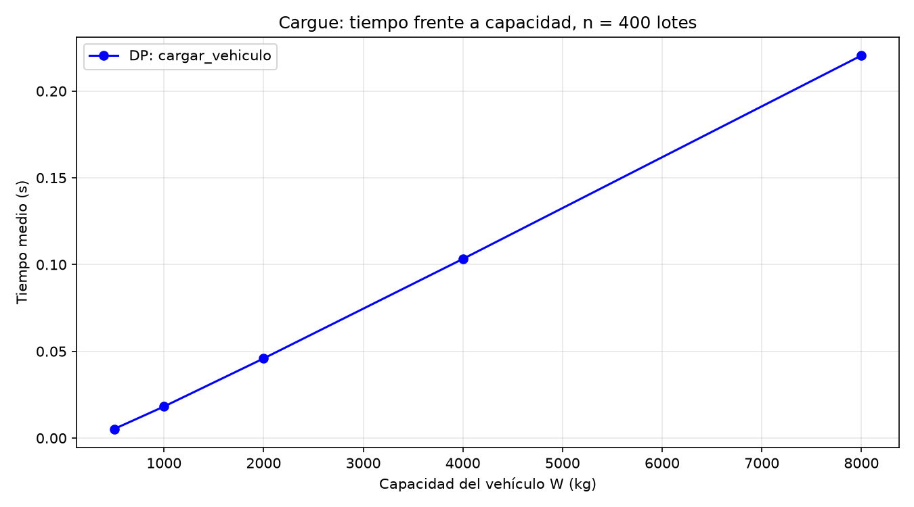

# Cargue de vehículos: mochila 0/1 con programación dinámica

**Caso 3 — Banco Regional de Alimentos**  
**Laboratorio Evaluativo 04 / Avance de Proyecto Final**

**Integrantes y roles**

* **Walter Alexander Pino Vásquez** — Estrategia algorítmica, modelado y recurrencia.
* **Ana María Colorado Varela** — Solución exhaustiva, reglas de cargue y contraejemplos.
* **Juan David Machado Mosquera** — Datos, pruebas y validación.
* **Franco Moncayo Uribe** — Mediciones, gráficas e integración.

**Código fuente en `src/cargue_vehiculos/`:**  
[estrategia.py](src/cargue_vehiculos/estrategia.py) · [pruebas_mochila.py](src/cargue_vehiculos/pruebas_mochila.py) · [medicion.py](src/cargue_vehiculos/medicion.py) · [exhaustivo.py](src/cargue_vehiculos/exhaustivo.py) · [regla_actual.py](src/cargue_vehiculos/regla_actual.py) · [pruebas_contraejemplos.py](src/cargue_vehiculos/pruebas_contraejemplos.py) · [datos.py](src/cargue_vehiculos/datos.py) · [pruebas.py](src/cargue_vehiculos/pruebas.py)

El Laboratorio 4 del 18 de noviembre de 2026 aborda la operación 3: cargue de vehículos. Los apartados pendientes del proyecto final se identifican para la entrega del 23 de noviembre.

**Preparación del entorno**

Desde la raíz del repositorio, en WSL Ubuntu:

```bash
# Crear el entorno virtual la primera vez
python3 -m venv .venvAnalisis

# Activar el entorno
source .venvAnalisis/bin/activate

# Instalar las dependencias
python -m pip install -r requirements.txt
```

Si el entorno ya existe, basta con activarlo. Los comandos para ejecutar las pruebas y las mediciones están en el [apartado 8](#8-instrucciones-de-reproducción).

---

## 1. Análisis del problema

### 1.1. Operación 3: cargue de vehículos

* **Entradas:** Para un vehículo, $n$ lotes candidatos (300 a 600 lotes por ruta), cada uno con `peso_kg` (entero positivo) y valor nutricional (raciones ponderadas por prioridad de categoría), y la capacidad máxima $W$ del vehículo (2.500 a 4.000 kg).
* **Salida:** El subconjunto de lotes que maximiza el valor nutricional transportado sin superar la capacidad $W$, junto con los índices ordenados de los lotes seleccionados.
* **Restricciones:**

  1. $\sum \text{peso}_i \le W$ (el vehículo nunca puede sobrecargarse).
  2. Lotes indivisibles (0/1: sube completo o no sube).
  3. El valor transportado debe ser el **máximo exacto**, no una heurística o aproximación.
  4. Los datos de entrada no se modifican (inmutabilidad para conservar la trazabilidad sanitaria).
* **Situación actual, según el caso de estudio:** El coordinador carga por orden de vencimiento (FEFO) hasta que el siguiente lote no cabe. Es un método voraz rápido, pero se detiene en el primer lote que no cabe y deja los camiones saliendo en promedio al **78 %** de su capacidad útil.

**Supuestos de esta operación:** se usan pesos enteros positivos en kg,
valores nutricionales no negativos y candidatos previamente filtrados como
aptos. Un lote que vence el día del despacho se admite; los vencidos se
excluyen con `filtrar_aptos`. Los pesos sintéticos (20–600 kg), las raciones
(2–4 por kg) y las prioridades (3, 2 y 1) son supuestos del equipo, detallados
en §3.2.1. En empates de vencimiento o densidad se conserva el orden original.
La ocupación mide peso/capacidad y no sustituye el objetivo nutricional.
La selección 0/1 y el orden sanitario de despacho son pasos distintos: los
lotes elegidos deben salir por vencimiento dentro de cada categoría. El
ordenamiento de bodega corresponde a la operación 2.

### 1.2. Análisis de las cuatro operaciones del banco

Pendiente para la entrega del 23 de noviembre

---

## 2. Diseño de la solución

### 2.1. Justificación de la programación dinámica

El problema tiene **subestructura óptima** y **subproblemas que se repiten (traslapados)**:

* **Subestructura óptima:** Si el lote $i$ está en la solución óptima para la capacidad $w$, el resto debe ser óptimo para los primeros $i-1$ lotes con capacidad residual $w - \text{peso}_i$.
* **Subproblemas traslapados:** Las mismas combinaciones de prefijo de lotes $i$ y capacidad residual $w$ se evalúan repetidamente. Sin memoria, una búsqueda exhaustiva revisa $2^n$ combinaciones; para $n = 600$, $2^{600} \approx 4 \times 10^{180}$, lo cual es completamente inviable.
* **Falla de reglas voraces:** Una regla voraz (sea por orden de vencimiento o por densidad de valor/peso) no garantiza el óptimo con objetos indivisibles (mochila 0/1). Con el ejemplo de la sección 2.3, el cargue por vencimiento obtiene valor 10 y el óptimo es 14. Como el cliente exige el valor máximo exacto, la regla voraz no cumple.

### 2.2. Recurrencia

Sea $V[i][w]$ el valor nutricional máximo alcanzable considerando únicamente los primeros $i$ lotes con una capacidad disponible de $w$ kg:

$$V[0][w] = 0 \quad \forall w \in [0, W]$$
$$V[i][w] = V[i-1][w] \quad \text{si } \text{peso}_i > w$$
$$V[i][w] = \max\Big(V[i-1][w], \; V[i-1][w - \text{peso}_i] + \text{valor}_i\Big) \quad \text{si } \text{peso}_i \le w$$

* El primer término representa la opción *(a)*: "no subir el lote $i$".
* El segundo término representa la opción *(b)*: "subir el lote $i$".
* La respuesta óptima final es $V[n][W]$.
* En [estrategia.py](src/cargue_vehiculos/estrategia.py) se optimiza la memoria usando un solo arreglo recorrido de derecha a izquierda ($W$ hacia $\text{peso}_i$) para asegurar que cada lote se tome a lo sumo una vez, registrando marcas por lote y capacidad en un `bytearray` para reconstruir la solución exacta en $\Theta(n)$.

### 2.3. Ejemplo resuelto a mano

Instancia reducida de cuatro lotes, con capacidad $W=7$ kg. Para el cálculo
manual se numeran del 1 al 4; el código devuelve índices desde 0.

| Lote | Peso (kg) | Valor nutricional | Días para vencer |
|---|---:|---:|---:|
| 1 | 5 | 10 | 1 |
| 2 | 4 | 7 | 2 |
| 3 | 3 | 5 | 3 |
| 4 | 2 | 4 | 4 |

| $i$ / $w$ | 0 | 1 | 2 | 3 | 4 | 5 | 6 | 7 |
|---|---:|---:|---:|---:|---:|---:|---:|---:|
| 0 | 0 | 0 | 0 | 0 | 0 | 0 | 0 | 0 |
| 1 | 0 | 0 | 0 | 0 | 0 | 10 | 10 | 10 |
| 2 | 0 | 0 | 0 | 0 | 7 | 10 | 10 | 10 |
| 3 | 0 | 0 | 0 | 5 | 7 | 10 | 10 | 12 |
| 4 | 0 | 0 | 4 | 5 | 7 | 10 | 11 | **14** |

1. Sin lotes, todos los valores son cero.
2. El lote 1 aporta 10 desde capacidad 5. Con el lote 2, $V[2][4]=7$;
   en capacidad 7 se conserva 10 porque los dos lotes pesan 9 kg.
3. Al considerar el lote 3, $V[3][7]=\max(10,7+5)=12$.
4. Con el lote 4, $V[4][7]=\max(V[3][7],V[3][5]+4)=\max(12,14)=14$.
5. Reconstrucción: se toma el lote 4 y quedan 5 kg. Las filas 3 y 2 no
   mejoran el valor de esa capacidad; se toma el lote 1 y quedan 0 kg.

La solución es **lotes 1 y 4**, índices `[0, 3]`: 7 kg y valor 14.
Vencimiento carga el lote 1 y se detiene ante el 2: valor 10 y 2 kg libres.
`probar_ejemplo_manual` verifica cada celda de la tabla y contrasta el óptimo
con la exhaustiva. El subcaso original de tres lotes se conserva en la suite
de mochila.

### 2.4. Estrategias de contraste

| Estrategia | Decisión y alcance |
|---|---|
| Exhaustiva | Genera los subconjuntos uno a uno, calcula peso y valor y conserva una selección factible de valor máximo. Sirve como referencia exacta para instancias pequeñas. |
| Vencimiento | Ordena por días para vencer ascendentes y carga lotes completos. Se detiene en el primer lote que no cabe. |
| Densidad | Ordena por valor nutricional/peso descendente. Omite los lotes que no caben y continúa con los restantes, sin fraccionarlos. |

Ambas reglas producen selecciones factibles, pero una decisión local puede excluir una combinación de mayor valor. Los dos contraejemplos de la sección 5 verifican esta limitación frente a la exhaustiva y la programación dinámica.

### 2.5. Estructuras de datos, diseño general y segunda operación crítica

Pendiente para la entrega del 23 de noviembre

---

## 3. Implementación

### 3.1. Interfaces y decisiones de implementación

Las cuatro funciones de cargue utilizan `Lote = tuple[int, int, int]`, correspondiente a `(peso_kg, valor_nutricional, dias_para_vencer)`. Reciben `lotes: list[Lote]` y `capacidad_kg: int`; devuelven `tuple[int, list[int]]`: valor nutricional e índices originales en base cero, ascendentes y sin repeticiones.

| Módulo | Funciones y particularidades |
|---|---|
| [exhaustivo.py](src/cargue_vehiculos/exhaustivo.py) | `cargar_exhaustivo(lotes, capacidad_kg)`: enumera por cantidad de lotes y luego por orden lexicográfico de índices. Entre óptimos empatados conserva el de menos lotes y, después, el menor orden lexicográfico. No almacena todos los subconjuntos. |
| [regla_actual.py](src/cargue_vehiculos/regla_actual.py) | `cargar_por_vencimiento(lotes, capacidad_kg)` y `cargar_por_densidad(lotes, capacidad_kg)`: conservan el orden de entrada en empates. La segunda compara razones exactamente con `Fraction`. |
| [estrategia.py](src/cargue_vehiculos/estrategia.py) | `cargar_vehiculo(lotes, capacidad_kg)`: valida las tuplas y adapta peso y valor a `mochila_01`, conservando la implementación y los índices. En empates, DP conserva la opción sin el lote evaluado; puede devolver otro óptimo que la exhaustiva. |

Las cuatro funciones no modifican la lista ni sus registros. Validan pesos enteros positivos, valores nutricionales enteros no negativos, días enteros y capacidad entera no negativa; rechazan booleanos como enteros. DP y las reglas reutilizan la validación de `exhaustivo.py`, sin ejecutar la búsqueda exhaustiva. Los candidatos deben ser aptos para despacho: estas funciones no filtran lotes vencidos.

### 3.2. Verificación

La suite de pruebas en [pruebas_mochila.py](src/cargue_vehiculos/pruebas_mochila.py) comprueba con `assert`:

* El ejemplo a mano (valor 12, lotes 2 y 3).
* Casos borde: lista vacía, capacidad 0, nada cabe, todo cabe, ajuste exacto y empates.
* 300 instancias aleatorias pequeñas comparadas contra la función `fuerza_bruta` de esa misma suite, verificando que el valor coincida exactamente y que los lotes elegidos no superen la capacidad.
* 100 instancias con parámetros del caso (pesos de 20 a 600 kg, $W$ de 2.500 a 4.000 kg) comprobando que la mochila 0/1 no es inferior a `cargue_por_vencimiento` de `estrategia.py` en esas instancias.
* Inmutabilidad de las listas de entrada y validación de tipos con `ValueError`.

[pruebas_contraejemplos.py](src/cargue_vehiculos/pruebas_contraejemplos.py) ejecuta dos instancias fijas de seis y cinco lotes. Comprueba con aserciones:

- Igualdad del valor óptimo entre `cargar_exhaustivo` y `mochila_01`, y valor estrictamente menor para la regla evaluada.
- Peso dentro de la capacidad, índices originales enteros, ordenados y únicos, y valor reconstruido sumando los registros completos, sin fraccionamiento.
- Inmutabilidad de los lotes y de las listas adaptadas para DP.
- Parada de vencimiento ante el primer lote que no cabe y continuación de densidad tras omitir lotes; ausencia de empates de densidad en ese contraejemplo.

Se reutiliza `verificar_solucion` de la suite existente. Los resultados exactos aparecen en la sección 5; los contraejemplos no miden tiempos ni energía.

#### 3.2.1. Datos sintéticos

[datos.py](src/cargue_vehiculos/datos.py) genera lotes con la estructura entregada por el cliente. Cada lote es un `RegistroLote` inmutable (`dataclass(frozen=True)`) con `codigo_lote`, `categoria`, `fecha_vencimiento`, `peso_kg`, `raciones` y `donante`; intentar modificarlo lanza `FrozenInstanceError`, lo que protege la trazabilidad sanitaria del registro original.

| Parámetro | Valor sintético | Fuente |
|---|---|---|
| Lotes candidatos por ruta | 300 a 600 | Enunciado del caso |
| Capacidad del vehículo | 2.500 a 4.000 kg | Enunciado del caso |
| Peso por lote | 20 a 600 kg, entero | Supuesto del equipo, igual al de `medicion.py` |
| Raciones | 2 a 4 por kg | Supuesto del equipo |
| Categorías | 40: 12 de proteína, 10 de frutas y verduras, 18 de otros | Enunciado (40 categorías y 3 grupos de prioridad) |
| Prioridad de la categoría | proteína 3, frutas y verduras 2, otros 1 | Supuesto del equipo |
| Vencimiento | 0 a 30 días tras el despacho; el inventario puede incluir lotes vencidos hasta hace 5 días | Supuesto del equipo |

El valor nutricional es `raciones × prioridad`, de modo que cada kilogramo aporta entre 2 y 12 unidades, el mismo rango que usa `medicion.py`. Las funciones públicas son:

| Función | Uso |
|---|---|
| `generar_inventario(n, semilla, fecha_despacho, incluir_vencidos)` | Inventario de `n` lotes con códigos únicos; puede incluir lotes vencidos para probar su exclusión. |
| `generar_ruta(semilla, n)` | Candidatos aptos de una ruta y capacidad del vehículo, en los rangos del caso. |
| `generar_instancia_pequena(n, semilla)` | Instancias pequeñas (1–16 lotes en las pruebas), con límites de capacidad del 30 % y 70 % del peso total redondeados hacia abajo, para contrastar con la exhaustiva. |
| `filtrar_aptos(lotes, fecha_despacho)` | Lista nueva sin los lotes vencidos; no modifica la entrada. |
| `a_tuplas(lotes, fecha_despacho)` | Convierte a `Lote = (peso_kg, valor_nutricional, dias_para_vencer)` para `exhaustivo.py` y `regla_actual.py`. |
| `a_listas(lotes)` | Separa pesos y valores para `mochila_01`, conservando los índices. |

Cada generador usa su propio `random.Random(semilla)`: la misma semilla reproduce exactamente los mismos datos y no altera el estado global de `random`. La semilla base es `SEMILLA_BASE = 2026` y la fecha de despacho de referencia es el 18 de noviembre de 2026.

#### 3.2.2. Suite consolidada

[pruebas.py](src/cargue_vehiculos/pruebas.py) es el punto único de verificación del cargue. Ejecuta los cuatro algoritmos (DP, exhaustiva, vencimiento y densidad) con la misma interfaz y aplica a cada salida la función `verificar_cargue`. Esa función comprueba que los índices sean enteros, únicos, ordenados y válidos; que el peso no supere la capacidad; y que el valor sea exactamente la suma de los registros completos elegidos. Así se verifica que ningún lote se fraccione. También comprueba que ningún algoritmo modifique los lotes recibidos.

| Prueba | Qué verifica |
|---|---|
| `probar_reproducibilidad` | Misma semilla, mismos datos; semilla distinta, datos distintos. |
| `probar_rangos_del_caso` | Pesos, categorías y códigos únicos en 2.000 lotes; 300 a 600 candidatos y 2.500 a 4.000 kg en 20 rutas, y que los candidatos no quepan todos en el vehículo. |
| `probar_registros_inmutables` | El registro original no puede modificarse. |
| `probar_filtrado_de_vencidos` | Filtra sin modificar el inventario y verifica selecciones aptas: DP y reglas sobre el conjunto filtrado; exhaustiva sobre ocho candidatos. |
| `probar_adaptadores` | `a_tuplas` y `a_listas` conservan el orden y la correspondencia de índices. |
| `probar_casos_limite` | 14 casos con valor óptimo conocido, para los cuatro algoritmos: sin lotes, capacidad cero, nada cabe, todo cabe, ajuste exacto, un kilogramo de menos, capacidad igual al peso total y uno menos, valores cero, pesos iguales, empate de valor, lote de 1 kg, lote más pesado que el vehículo y lote que vence el día del despacho. |
| `probar_ejemplo_manual` | Todas las celdas del ejemplo de cuatro lotes y óptimo 14, índices `[0, 3]`. |
| `probar_desempates` | Estabilidad por fecha y densidad; comportamiento de DP y exhaustiva entre óptimos. |
| `probar_excepciones` | Capacidad negativa, peso no positivo, valor negativo, números no enteros, booleanos y tuplas mal formadas lanzan `ValueError` en las cuatro interfaces. |
| `probar_aleatorias_contra_exhaustiva` | 40 instancias aleatorias (el mínimo exigido es 20) de 1 a 16 lotes, con semillas 1000 a 1039: la DP alcanza el mismo valor que `cargar_exhaustivo` y ninguna regla voraz lo supera. |
| `probar_rutas_tamano_real` | 3 rutas de tamaño real: cargues válidos y DP con valor mayor o igual al de ambas reglas. La exhaustiva no se ejecuta a este tamaño ($2^{300}$ subconjuntos o más). |
| `ejecutar_suites_previas` | Ejecuta todas las pruebas de `pruebas_mochila.py` y `pruebas_contraejemplos.py`, sin imprimir sus tablas. |

**Resultados de la ejecución.** Los 12 grupos de pruebas pasaron con Python 3.14.7. En las 40 instancias aleatorias la DP coincidió con la exhaustiva; la regla por vencimiento quedó por debajo del óptimo en 34 de ellas. En las tres rutas de tamaño real, la DP ocupó el 100 % de la capacidad del vehículo:

| Ruta (semilla) | Lotes candidatos | Capacidad (kg) | Peso cargado por DP (kg) | Ocupación |
|---|---|---|---|---|
| 0 | 497 | 3.361 | 3.361 | 100,0 % |
| 1 | 368 | 3.665 | 3.665 | 100,0 % |
| 2 | 328 | 2.687 | 2.687 | 100,0 % |

Estas ocupaciones dependen de los datos sintéticos, que contienen muchos lotes pequeños; no son una medición sobre datos reales del banco. Sirven como contraste con el 78 % promedio que reporta el caso para el cargue actual.

`medicion.py` usa estos mismos generadores y las cuatro funciones de cargue. La suite original conserva su fuerza bruta como oráculo independiente; las mediciones usan únicamente `cargar_exhaustivo`.

---

## 4. Evaluación del desempeño

### 4.1. Complejidad teórica

Sea $n$ el número de lotes y $W$ la capacidad entera en kilogramos. Las cotas se expresan bajo aritmética de costo constante y, para DP, con $n,W \ge 1$.

| Estrategia | Tiempo | Memoria adicional | Operaciones dominantes |
|---|---|---|---|
| Programación dinámica existente | $\Theta(nW)$ | $\Theta(nW)$ | Actualización de valores y matriz de marcas para reconstrucción. |
| Exhaustiva | $\Theta(n2^n)$ | $O(n)$ | Evaluación de los elementos de cada subconjunto. |
| Vencimiento | $O(n\log n)$, peor caso | $O(n)$ | Ordenación por fecha y ordenación final de los índices elegidos. |
| Densidad | $O(n\log n)$, peor caso | $O(n)$ | Ordenación por razón valor/peso y de los índices elegidos. |

* **Programación dinámica — tiempo:** Hay $n$ lotes candidatos y, para cada uno, se evalúan a lo sumo $W$ capacidades en tiempo constante. La creación de marcas también recorre un espacio proporcional a $nW$; la reconstrucción toma $\Theta(n)$.
* **Programación dinámica — espacio:** El arreglo unidimensional de valores ocupa $\Theta(W)$. La matriz de marcas para reconstruir ocupa $\Theta(nW)$ bytes (con 600 lotes y $W = 4000$ kg son $\approx 2{,}4\text{ MB}$, sin incluir la sobrecarga de los objetos Python).
* **Naturaleza pseudopolinomial:** el costo depende del valor numérico de $W$, no de su número de bits. Expresar los mismos pesos y capacidad en gramos multiplicaría $W$ por 1000, aumentando proporcionalmente el trabajo de la tabla y las marcas.

**Exhaustiva:** se generan $2^n$ subconjuntos, pero cada uno requiere sumar los pesos y valores de sus elementos. La suma de sus tamaños es $n2^{n-1}$ para $n\ge1$, lo que justifica $\Theta(n2^n)$. El iterador, la combinación actual y la mejor selección ocupan $O(n)$; no se guardan todas las combinaciones. Aumentar $W$ no cambia el número de subconjuntos.

**Reglas:** validar y recorrer cuesta $O(n)$; ordenar los candidatos y los índices seleccionados domina el peor caso. `Fraction` evita errores de redondeo al comparar densidades, aunque su costo aritmético depende del tamaño en bits de pesos y valores. La capacidad modifica las decisiones, sin crear una tabla de tamaño $W$.

**Crecimiento:** con $W$ fijo, duplicar $n$ duplica el término $nW$; en exhaustiva, el término $n2^n$ se multiplica por $2^{n+1}$. La cota $n\log n$ de las reglas crece algo más del doble. Aumentar $W$ afecta directamente al costo de DP. Estas relaciones son teóricas, no tiempos medidos.

### 4.2. Mediciones y gráficas

[medicion.py](src/cargue_vehiculos/medicion.py) usa [datos.py](src/cargue_vehiculos/datos.py),
semilla 42 y las funciones `cargar_vehiculo`, `cargar_exhaustivo`,
`cargar_por_vencimiento` y `cargar_por_densidad`. Las instancias son prefijos
del mismo inventario sintético apto, con pesos de 20–600 kg. Cada algoritmo
recibe exactamente los mismos lotes para cada par $(n,W)$.

Antes de cronometrar se valida capacidad, valor, índices e inmutabilidad.
En los ocho tamaños pequeños se exige que DP y exhaustiva coincidan, y que
las reglas no superen el óptimo. Esta ejecución previa también sirve de
calentamiento. Se mide la función completa con `time.perf_counter()`,
incluidas validación, ordenación y reconstrucción, durante **cinco
repeticiones**; se publica la **media aritmética**. La generación, la
verificación externa, los conteos y el dibujo quedan fuera del cronómetro.

Los tiempos individuales, selecciones, semillas, huellas de las entradas y
el entorno se conservan en [resultados.json](graficas/cargue_vehiculos/resultados.json).
La ejecución registrada usa Python 3.14.7 sobre WSL Ubuntu, en un solo hilo.
Los tiempos dependen de la carga del equipo; las cifras de las tablas están
redondeadas y los cocientes se calculan antes del redondeo.

#### 4.2.1. Tiempo frente al número de lotes


El panel izquierdo compara las cuatro soluciones con $W=1000$ kg; el
derecho muestra DP y reglas hasta 2000 lotes, con $W=4000$ kg. La escala
logarítmica permite distinguir las curvas más rápidas.

| $n$ | DP (ms) | Exhaustiva (ms) | Vencimiento (ms) | Densidad (ms) |
|---:|---:|---:|---:|---:|
| 4 | 0,273526 | 0,025087 | 0,007528 | 0,014079 |
| 6 | 0,434409 | 0,075378 | 0,008437 | 0,017849 |
| 8 | 0,545298 | 0,411054 | 0,009851 | 0,023005 |
| 10 | 0,521212 | 1,129124 | 0,021637 | 0,054098 |
| 12 | 0,714171 | 6,107675 | 0,014746 | 0,039478 |
| 14 | 0,806153 | 24,653482 | 0,017094 | 0,050858 |
| 16 | 0,884439 | 82,821107 | 0,015682 | 0,043914 |
| 18 | 0,987400 | 358,612014 | 0,016125 | 0,048586 |

Escalabilidad con $W=4000$ kg:

| $n$ | DP (ms) | Vencimiento (ms) | Densidad (ms) |
|---:|---:|---:|---:|
| 50 | 13,221871 | 0,034718 | 0,156358 |
| 100 | 24,478858 | 0,185418 | 0,405644 |
| 200 | 51,483919 | 0,120957 | 0,839582 |
| 400 | 110,398151 | 0,314673 | 1,428155 |
| 600 | 163,828430 | 0,368933 | 2,422264 |
| 1000 | 252,314926 | 0,746552 | 3,941349 |
| 2000 | 488,327088 | 1,562111 | 8,786330 |

#### 4.2.2. Conteos y contraste al duplicar el tamaño


Los contadores observan ejecuciones reales mediante `sys.settrace`, en una
llamada separada: DP cuenta actualizaciones candidatas de celdas; exhaustiva,
subconjuntos; las reglas, comparaciones de capacidad. Se comprueban además
las identidades $\sum_i\max(0,W-p_i+1)$ y $2^n$. La instrumentación se retira
al terminar y no interviene en los tiempos.

| $n$ | Celdas DP | Subconjuntos | Comparaciones vencimiento | Comparaciones densidad |
|---:|---:|---:|---:|---:|
| 4 | 3080 | 16 | 4 | 4 |
| 6 | 4457 | 64 | 4 | 6 |
| 8 | 5787 | 256 | 4 | 8 |
| 10 | 7038 | 1024 | 5 | 10 |
| 12 | 8569 | 4096 | 5 | 12 |
| 14 | 10115 | 16384 | 5 | 14 |
| 16 | 11532 | 65536 | 4 | 16 |
| 18 | 13058 | 262144 | 4 | 18 |

Para $n=8$ y $n=16$, con la misma capacidad:

| Estrategia | Factor de tiempo | Factor del conteo | Referencia teórica |
|---|---:|---:|---|
| DP | 1,6219 | 1,9927 | 2 para $nW$; las celdas útiles dependen de los pesos |
| Exhaustiva | 201,4847 | 256,0000 | 512 para $n2^n$; 256 para los subconjuntos |
| Vencimiento | 1,5919 | 1,0000 | 8/3 para la cota $n\log_2 n$; el conteo excluye ordenar |
| Densidad | 1,9089 | 2,0000 | 8/3 para la cota $n\log_2 n$; el recorrido compara $n$ lotes |

La exhaustiva explora exactamente 256 veces más subconjuntos al pasar de 8
a 16 lotes, pero debe sumar más elementos por subconjunto; el conteo no
representa todas sus operaciones. DP también reserva e inicializa marcas,
además de actualizar celdas. En vencimiento el recorrido puede detenerse
pronto, aunque todas las entradas se validan y ordenan. Densidad revisa
todos los lotes, pero su tiempo incluye `Fraction` y la ordenación.

Los factores temporales no coinciden exactamente con las cotas: son
instancias pequeñas, con costos fijos, distinta cantidad de celdas útiles
y ruido del sistema. Las fluctuaciones también explican que alguna
medición disminuya al aumentar $n$; no se descartan esas repeticiones.
Las cotas describen crecimiento asintótico, no garantizan un cociente
exacto para dos mediciones.

#### 4.2.3. Tiempo frente a capacidad



Se conservan los mismos 400 lotes y solo cambia $W$.

| $W$ (kg) | DP (s) | Celdas evaluadas | ns por celda |
|---:|---:|---:|---:|
| 500 | 0,00522916 | 77074 | 67,846 |
| 1000 | 0,01818258 | 273350 | 66,518 |
| 2000 | 0,04589030 | 673350 | 68,152 |
| 4000 | 0,10324299 | 1473350 | 70,074 |
| 8000 | 0,22046613 | 3073350 | 71,735 |

De 1000 a 2000 kg, el tiempo se multiplica por **2,5239**
y las celdas por **2,4633**.
De 2000 a 4000 kg los factores son **2,2498** y
**2,1881**, respectivamente. Las celdas crecen
más del doble porque el límite inferior de cada recorrido depende del peso
del lote. Los resultados son compatibles con la dependencia de $W$;
no constituyen una demostración experimental de la cota.

### 4.3. Extrapolación al volumen real

Se considera el extremo de 600 lotes por ruta, 4000 kg y 14 vehículos
procesados secuencialmente. Los modelos se calibran con las medias del
registro anterior, no con una constante temporal supuesta:

- **DP:** referencia de 2000 lotes y 4000 kg, 0,488327088 s; se escala con $nW$.
- **Vencimiento:** 0,001562111 s para 2000 lotes; se usa $n\log_2 n$ para modelar la ordenación.
- **Densidad:** 0,008786330 s para 2000 lotes; se adopta el mismo modelo $n\log_2 n$.
- **Exhaustiva:** 0,358612014 s para 18 lotes; se escala con $n2^n$. La capacidad no cambia el número de subconjuntos ni las dos sumas de esta implementación.

Los factores son $600/2000$ para DP, $(600\log_2 600)/(2000\log_2 2000)$
para las reglas y $(600/18)2^{600-18}$ para exhaustiva. Para DP, el cociente
$W/W_{\rm ref}$ vale uno. El modelo de las reglas supone que domina ordenar;
los empates de fecha y los costos lineales pueden cambiar el factor real.
La extrapolación exponencial solo ilustra inviabilidad: no se ejecutó
exhaustiva sobre 600 lotes.

| Estrategia | Tiempo estimado por vehículo (s) | Tiempo estimado de 14 vehículos (s) | Ventana de 7200 s |
|---|---:|---:|---|
| DP | 0,146498 | 2,050974 | Cabe en el modelo |
| Exhaustiva | 1,892174e+176 | 2,649044e+177 | No es viable |
| Vencimiento | 0,000394 | 0,005522 | Cabe en el modelo |
| Densidad | 0,002218 | 0,031057 | Cabe en el modelo |

Como comprobación del modelo, la instancia sintética de 600 lotes tardó
**0,163828430 s** por vehículo, frente a la estimación de
**0,146498126 s**. La diferencia absoluta relativa
a la medición es **10,58 %**.
Esto muestra la incertidumbre de trasladar una constante entre tamaños.

### 4.4. Ajuste a la ventana y límites

La ventana de 03:00 a 05:00 se comparte con las operaciones 1 y 2.
El cómputo estimado de DP ocupa **2,050974 s** para
los 14 vehículos, por debajo de las dos horas, pero no certifica el tiempo
del proceso completo. La exhaustiva resulta inviable a escala real.

Las proyecciones suponen un computador con rendimiento comparable al usado
en las mediciones, iguales unidades de capacidad y condiciones semejantes.
No incluyen consultas, lectura de archivos, preparación de candidatos ni
alistamiento. La energía y su diferencia anual se calculan en §6.1.

### 4.5. Línea base energética del proceso completo

Pendiente para la entrega del 23 de noviembre

---

## 5. Análisis comparativo

Las instancias siguientes son sintéticas, con capacidad reducida de **1000 kg** para facilitar su revisión manual. No representan el volumen operativo real. Los índices son originales, en base cero. Los resultados se obtienen ejecutando [pruebas_contraejemplos.py](src/cargue_vehiculos/pruebas_contraejemplos.py); la diferencia es valor óptimo menos valor de la regla.

### 5.1. Contraejemplo por vencimiento

| Índice | Peso (kg) | Valor nutricional | Días para vencer |
|---|---:|---:|---:|
| 0 | 450 | 900 | 4 |
| 1 | 300 | 180 | 1 |
| 2 | 550 | 1100 | 5 |
| 3 | 500 | 250 | 2 |
| 4 | 250 | 400 | 3 |
| 5 | 150 | 200 | 6 |

| Método | Índices | Peso (kg) | Valor nutricional | Diferencia (unidades) |
|---|---|---:|---:|---:|
| Vencimiento | `[1, 3]` | 800 | 430 | 1570 |
| Exhaustiva | `[0, 2]` | 1000 | 2000 | 0 |
| DP | `[0, 2]` | 1000 | 2000 | 0 |

El orden por vencimiento es `[1, 3, 4, 0, 2, 5]`. Después de cargar 1 y 3 quedan 200 kg; el lote 4 pesa 250 kg y provoca la parada. La regla no alcanza el lote 5, que sí cabría. Además, priorizar fechas excluye la combinación de 0 y 2, cuyo valor supera al de la regla en **1570 unidades**. La exhaustiva y DP coinciden en valor y selección para esta instancia.

### 5.2. Contraejemplo por densidad

| Índice | Peso (kg) | Valor nutricional | Días para vencer |
|---|---:|---:|---:|
| 0 | 500 | 950 | 4 |
| 1 | 600 | 1320 | 1 |
| 2 | 100 | 80 | 5 |
| 3 | 500 | 1000 | 2 |
| 4 | 200 | 100 | 3 |

| Método | Índices | Peso (kg) | Valor nutricional | Diferencia (unidades) |
|---|---|---:|---:|---:|
| Densidad | `[1, 2, 4]` | 900 | 1500 | 450 |
| Exhaustiva | `[0, 3]` | 1000 | 1950 | 0 |
| DP | `[0, 3]` | 1000 | 1950 | 0 |

Las densidades exactas dan el orden `[1, 3, 0, 2, 4]`: $11/5 > 2 > 19/10 > 4/5 > 1/2$. No hay empates. El lote 1, de mayor densidad, deja 400 kg disponibles e impide cargar 0 y 3, de 500 kg cada uno. La regla los omite y continúa con 2 y 4, pero obtiene **450 unidades menos** que el óptimo. Continuar tras un lote que no cabe no corrige la decisión inicial.

### 5.3. Condición en que densidad sería óptima

Si se permitiera dividir los lotes y el valor nutricional fuera proporcional a la cantidad cargada, el problema sería una mochila fraccionaria. Cargar por densidad descendente y tomar la fracción necesaria del siguiente lote sería óptimo: sustituir peso de menor densidad por igual peso de mayor densidad no reduce el valor. Esta condición no se cumple en el banco, donde los lotes son indivisibles. `cargar_por_densidad` implementa una heurística 0/1, no la solución fraccionaria.

### 5.4. Calidad del cargue en catorce rutas sintéticas

Se ejecutaron DP y las dos reglas sobre las mismas rutas de `generar_ruta`,
con semillas 142 a 155, entre 300 y 600 lotes por ruta y capacidades de
2500–4000 kg. La capacidad conjunta es **45899 kg**; cada vehículo se
comprueba por separado. No se ejecuta exhaustiva a estos tamaños. Las
selecciones y los resultados de cada ruta están en `resultados.json`.

| Estrategia | Peso total (kg) | Ocupación conjunta | Valor nutricional total |
|---|---:|---:|---:|
| Vencimiento | 43269 | 94,2700 % | 235168 |
| Densidad | 45809 | 99,8039 % | 549318 |
| DP | 45899 | 100,0000 % | 550788 |

DP aporta **315620 unidades más** que vencimiento, un incremento de
**134,2104 %** respecto al valor de esa regla.
La ocupación conjunta aumenta **5,7300 puntos porcentuales**.
Se calcula como peso total/capacidad total, no como promedio simple de los
porcentajes por ruta.

La ocupación y el valor nutricional son métricas diferentes. Estos resultados
sintéticos no permiten inferir raciones reales adicionales, desperdicio
evitado ni emisiones reducidas. El 78 % del caso corresponde al proceso
real; no es la línea base de esta simulación.

### 5.5. Recomendación para el cargue

Se recomienda DP porque entrega el máximo valor nutricional con lotes
indivisibles y capacidad limitada. Vencimiento y densidad son más rápidas,
pero sus contraejemplos muestran que incumplen el objetivo exacto. La
exhaustiva se conserva para validar instancias pequeñas.

DP requiere memoria proporcional a $nW$ y depende de la unidad en que se
exprese el peso. La recomendación supone capacidades enteras en kilogramos;
capacidades mucho mayores exigen revisar tiempo y memoria. La aptitud
sanitaria y el orden FEFO de salida deben garantizarse en el flujo de
despacho, sin confundir la prioridad sanitaria con maximizar el valor.

### 5.6. Comparación integral de las operaciones

Pendiente para la entrega del 23 de noviembre

---

## 6. Implicaciones éticas, sociales y ambientales

### 6.1. Consumo energético del cargue

Se usa la potencia aproximada de 150 W = 0,15 kW indicada por el caso y
300 días operativos anuales, con un cálculo diario por cada uno de los
14 vehículos. Para cada estrategia:

$$E_{\text{día}}\;(\mathrm{kWh})=0{,}15\cdot\frac{14t_{\text{vehículo}}}{3600},
\qquad E_{\text{año}}=300E_{\text{día}}.$$

| Estrategia | Energía estimada por día (kWh) | Proyección de 300 días (kWh) |
|---|---:|---:|
| DP | 0,000085457 | 0,025637172 |
| Exhaustiva | 1,103768e+173 | 3,311304e+175 |
| Vencimiento | 0,000000230 | 0,000069020 |
| Densidad | 0,000001294 | 0,000388216 |

La diferencia anual **DP menos vencimiento** es **0,025568152 kWh**.
Es positiva: DP exige más energía de cómputo que la regla actual bajo este
modelo, a cambio de obtener el óptimo. No se afirma un ahorro eléctrico
frente a vencimiento. Frente a exhaustiva, DP evita un costo impracticable.

El valor astronómico de exhaustiva es la consecuencia formal de proyectar
una tarea que no terminaría; no es una previsión realizable de consumo anual.
Los demás valores también son estimaciones de cómputo, sin medición eléctrica
directa y sin incluir el consumo en reposo ni el proceso completo del banco.

### 6.2. Consideraciones sociales y ambientales

* **Equidad en la distribución (personas):** Maximizar ciegamente el valor nutricional global podría desfavorecer a comedores comunitarios o jardines infantiles de rutas específicas si sus lotes solicitados aportan menor valor bruto. **Mitigación algorítmica:** Establecer cuotas mínimas reservadas por tipo de población beneficiaria o aplicar factores de ponderación social antes de resolver la mochila. Las cuotas requieren modificar el modelo y no están implementadas en la solución actual.
* **Seguridad alimentaria (FEFO):** La mochila selecciona los lotes; antes se excluyen los vencidos y, después, los seleccionados deben despacharse por vencimiento dentro de cada categoría. La operación 2 aborda el ordenamiento sanitario de bodega.
* **Trazabilidad sanitaria:** `mochila_01` no modifica los datos de entrada, lo que facilita vincular la selección con los registros originales; una auditoría sanitaria completa requiere además identificadores y registros persistentes.
* **Impacto ambiental y reducción de desperdicio:** El Caso 3 suministra un factor de **2,5 kg de $\text{CO}_2$ equivalente** por kilogramo de alimento desechado. Este factor permitiría estimar emisiones evitadas si se midieran los kilogramos de desperdicio realmente reducidos. Los contraejemplos y la simulación sintética no permiten cuantificar ese impacto real.
* **Escenario de crecimiento:** Si se duplican los vehículos y se conserva el tamaño de cada ruta, el modelo duplica el costo del cargue. El escenario completo de segunda bodega exige además revisar el crecimiento del inventario y de las demás operaciones.

### 6.3. Normativa, impacto en organizaciones beneficiarias y trazabilidad sanitaria integral

Pendiente para la entrega del 23 de noviembre

---

## 7. Conclusiones

### 7.1. Conclusiones de la operación 3

En los dos contraejemplos, la exhaustiva y DP alcanzan el mismo valor óptimo. Vencimiento pierde 1570 unidades y densidad pierde 450 frente a ese óptimo; por tanto, ninguna regla garantiza maximizar el valor nutricional con lotes indivisibles. La exhaustiva sirve para verificar casos pequeños, pero su crecimiento exponencial impide aplicarla al volumen real. Se mantiene DP como estrategia propuesta, con costo pseudopolinomial en la capacidad. Las mediciones integradas y sus repeticiones respaldan la viabilidad computacional estimada de DP para el cargue, sin certificar las otras operaciones. Su ventaja frente a la regla actual es la calidad óptima de la selección, no un ahorro eléctrico de cómputo.

### 7.2. Conclusiones integrales del proyecto

Pendiente para la entrega del 23 de noviembre

---

## 8. Instrucciones de reproducción

Desde la raíz del repositorio, con el entorno `.venvAnalisis` activado. Se utilizó Python 3.14.7 y las dependencias de [requirements.txt](requirements.txt).

```bash
# Suite consolidada: datos, casos límite, contraste con la exhaustiva
# y ejecución de las dos suites siguientes
python -B src/cargue_vehiculos/pruebas.py

# Ejemplo de ruta sintética generada con la semilla base
python -B src/cargue_vehiculos/datos.py

# Pruebas de mochila
python -B src/cargue_vehiculos/pruebas_mochila.py

# Contraejemplos de vencimiento y densidad
python -B src/cargue_vehiculos/pruebas_contraejemplos.py
```

`pruebas.py` no requiere dependencias externas. Las suites se ejecutaron correctamente. `pruebas_contraejemplos.py` imprime tablas de lotes, selecciones, pesos, valores y diferencias. Todas deben ejecutarse sin `-O`, para conservar las aserciones.

```bash
# Ejecutar mediciones y generar las tres gráficas
python -B src/cargue_vehiculos/medicion.py
```

El último comando guarda las repeticiones en
`graficas/cargue_vehiculos/resultados.json` y regenera las tres imágenes.
Una nueva ejecución puede producir tiempos diferentes; las tablas y el
análisis deben corresponder al mismo registro de resultados.

Para reconstruir solo las gráficas con los datos publicados, sin medir de
nuevo:

```bash
python -B src/cargue_vehiculos/medicion.py --solo-graficas
```

### 8.1. Exportación del informe a PDF

Pendiente para la entrega del 23 de noviembre
