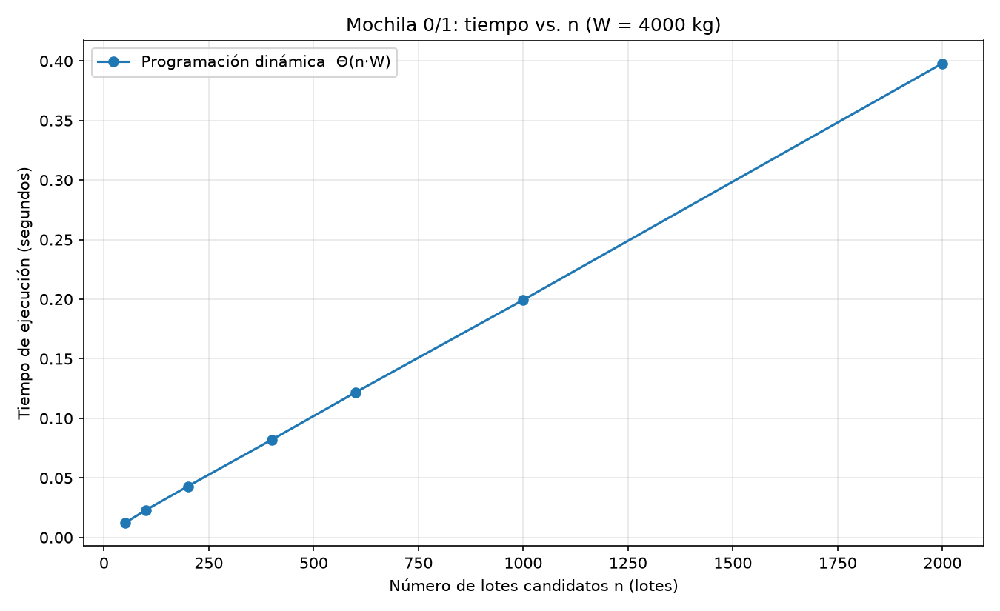
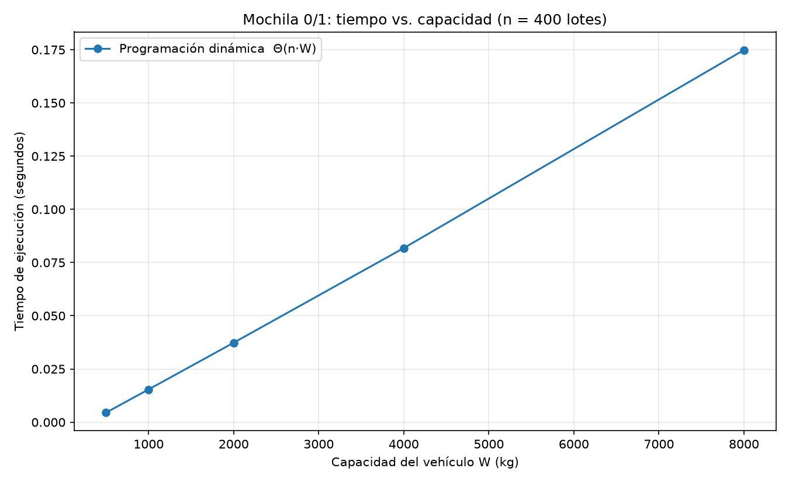

# Cargue de vehículos: mochila 0/1 con programación dinámica

**Caso 3 — Banco Regional de Alimentos · Integrante 1 (estrategia de cargue)**

**Nombre completo:** Walter Alexander Pino Vasquez

Código: [estrategia.py](estrategia.py) · [pruebas_mochila.py](pruebas_mochila.py) · [medicion_mochila.py](medicion_mochila.py)

## Cómo reproducir

```bash
venv\Scripts\activate            # Linux/Mac: source venv/bin/activate
cd src/cargue_vehiculos
python pruebas_mochila.py        # pruebas
python medicion_mochila.py       # mediciones y gráficas (carpeta graficas/)
```

---

## 1. El problema de esta operación

- **Entradas:** para un vehículo, `n` lotes candidatos (300 a 600), cada uno con `peso_kg` (entero) y valor nutricional (raciones ponderadas por prioridad), y la capacidad `W` (2.500 a 4.000 kg).
- **Salida:** el subconjunto de lotes que maximiza el valor total y los índices de los lotes elegidos.
- **Restricciones:** la suma de pesos no supera `W`; un lote sube completo o no sube; el valor debe ser el máximo exacto, no una aproximación; los datos del lote no se modifican (la función solo lee las listas).

El cargue actual sube lotes por orden de vencimiento hasta que el siguiente no cabe. Es rápido, pero se detiene en el primer lote que no cabe y deja espacio sin usar.

## 2. Por qué admite programación dinámica

El problema tiene **subestructura óptima** y **subproblemas que se repiten**:

- Si el lote `i` está en la solución óptima para la capacidad `w`, el resto debe ser óptimo para los lotes `1..i-1` con capacidad `w - peso_i`.
- Los mismos subproblemas (primeros `i` lotes, capacidad `w`) se necesitan muchas veces. Sin memoria, la búsqueda por subconjuntos revisa 2ⁿ combinaciones; con `n = 600` es inviable.
- Un voraz (por densidad valor/peso o por vencimiento) no garantiza el óptimo con lotes indivisibles. Con el ejemplo de la sección 4, el cargue por vencimiento obtiene 10 y el óptimo es 12. El enunciado exige el máximo exacto, así que el voraz no cumple.

## 3. Recurrencia

Sea `V[i][w]` el mejor valor usando solo los primeros `i` lotes con capacidad `w`:

```
V[0][w] = 0
V[i][w] = V[i-1][w]                                      si peso_i > w
V[i][w] = max( V[i-1][w],  V[i-1][w - peso_i] + valor_i )   si peso_i ≤ w
```

El primer término es "no subo el lote `i`"; el segundo, "lo subo". La respuesta es `V[n][W]`. En el código se usa un solo arreglo recorrido de derecha a izquierda (así cada lote se usa a lo sumo una vez) y una marca por lote y capacidad que indica si convino tomarlo.

**Reconstrucción:** se parte de `w = W` y se recorren los lotes del último al primero. Si el lote `i` quedó marcado para la capacidad `w`, se toma y `w` baja en `peso_i`. Los índices se devuelven ordenados.

**Garantía de capacidad:** la tabla solo permite `w - peso_i ≥ 0`, y la reconstrucción resta exactamente esos pesos. Las pruebas comprueban `sum(pesos[i]) ≤ capacidad` en cada instancia.

## 4. Ejemplo resuelto a mano

Capacidad `W = 7`; lotes (peso, valor): lote 1 = (5, 10), lote 2 = (4, 7), lote 3 = (3, 5).

| i \ w | 0 | 1 | 2 | 3 | 4 | 5 | 6 | 7 |
|---|---|---|---|---|---|---|---|---|
| 0 | 0 | 0 | 0 | 0 | 0 | 0 | 0 | 0 |
| 1 | 0 | 0 | 0 | 0 | 0 | 10 | 10 | 10 |
| 2 | 0 | 0 | 0 | 0 | 7 | 10 | 10 | 10 |
| 3 | 0 | 0 | 0 | 5 | 7 | 10 | 10 | **12** |

- `V[3][7] = max(V[2][7], V[2][4] + 5) = max(10, 7 + 5) = 12`.
- Reconstrucción: `V[3][7] ≠ V[2][7]` → se toma el lote 3, `w = 4`. `V[2][4] = 7 ≠ V[1][4] = 0` → se toma el lote 2, `w = 0`. `V[1][0] = V[0][0]` → no se toma el lote 1.
- Solución: lotes 2 y 3 (4 + 3 = 7 kg), valor 12. El cargue por vencimiento sube el lote 1 (5 kg), el lote 2 ya no cabe, y obtiene solo 10.

Esta tabla coincide con la que calcula el programa, y la prueba `probar_ejemplo_a_mano` verifica `(12, [1, 2])` con índices base 0.

## 5. Complejidad

- **Tiempo:** hay `n` lotes y, para cada uno, se actualizan a lo sumo `W` capacidades en tiempo constante: **Θ(n·W)**. La reconstrucción cuesta Θ(n).
- **Espacio:** el arreglo de valores usa Θ(W). Las marcas para reconstruir ocupan Θ(n·W) bytes: con 600 lotes y 4.000 kg son unos 2,4 MB. Si solo se quisiera el valor máximo, bastaría Θ(W).
- **Aclaración:** Θ(n·W) es *pseudopolinomial*: depende del valor numérico de `W`, no del número de bits para escribirlo. Aquí `W` es de unos miles de kg, así que es práctico. Con pesos en gramos en lugar de kg, `W` se multiplicaría por 1.000 y el costo también.

## 6. Verificación

[pruebas_mochila.py](pruebas_mochila.py) comprueba con `assert`:

- El ejemplo a mano (valor 12, lotes 2 y 3).
- Casos borde: lista vacía, capacidad 0, nada cabe, todo cabe, ajuste exacto y empates.
- 300 instancias aleatorias pequeñas donde el valor coincide con una fuerza bruta sobre todos los subconjuntos, y donde los índices respetan la capacidad y suman el valor devuelto.
- 100 instancias con rangos del caso (pesos de 20 a 600 kg, capacidades de 2.500 a 4.000 kg) donde la mochila nunca es peor que el cargue por vencimiento.
- Una instancia de 600 lotes y 4.000 kg, que las listas de entrada no se modifican y los `ValueError` para entradas inválidas.

## 7. Medición, gráficas y energía

Datos sintéticos con semilla fija (42): pesos enteros de 20 a 600 kg y valor = peso × un factor de 2 a 12 (representa raciones por kg según la categoría). Se cronometra solo la llamada a `mochila_01` con `time.perf_counter()` y se reporta el menor de 3 repeticiones. Las "celdas" son las actualizaciones del ciclo interno, contadas con una fórmula exacta.

### Experimento A: tiempo vs. n (W = 4.000 kg)



| n | Tiempo (s) | Celdas | ns por celda |
|---|---|---|---|
| 50 | 0,0121 | 186.143 | 65,1 |
| 100 | 0,0230 | 370.279 | 62,1 |
| 200 | 0,0429 | 739.655 | 58,0 |
| 400 | 0,0820 | 1.480.428 | 55,4 |
| 600 | 0,1218 | 2.215.191 | 55,0 |
| 1.000 | 0,1994 | 3.686.799 | 54,1 |
| 2.000 | 0,3980 | 7.370.671 | 54,0 |

### Experimento B: tiempo vs. capacidad (n = 400)



| W (kg) | Tiempo (s) | Celdas | ns por celda |
|---|---|---|---|
| 500 | 0,0045 | 84.223 | 53,5 |
| 1.000 | 0,0154 | 280.428 | 54,9 |
| 2.000 | 0,0373 | 680.428 | 54,9 |
| 4.000 | 0,0818 | 1.480.428 | 55,3 |
| 8.000 | 0,1749 | 3.080.428 | 56,8 |

### Contraste con Θ(n·W)

- **Al duplicar n** (con W fija el número de celdas se duplica): de 100 a 200 lotes el tiempo se multiplica por 0,0429 / 0,0230 ≈ **1,87**; de 200 a 400, por 0,0820 / 0,0429 ≈ **1,91**; de 1.000 a 2.000, por 0,3980 / 0,1994 ≈ **2,00**. Θ(n·W) predice ×2.
- **Al duplicar W:** de 2.000 a 4.000 kg el tiempo se multiplica por 0,0818 / 0,0373 ≈ **2,19**, y de 4.000 a 8.000 por 0,1749 / 0,0818 ≈ **2,14**. Aquí el número de celdas no se duplica exactamente, porque los pesos de los lotes (20 a 600 kg) recortan el rango útil de capacidades: las celdas crecen ×2,18 y ×2,08 en esos mismos tramos. El tiempo sigue al número de celdas, no a W por sí sola.
- **Lectura:** las dos curvas son líneas casi rectas y el costo por celda queda entre 53,5 y 56,8 ns para n ≥ 200 (variación de unos 5 %). Esa constancia es la evidencia más directa de Θ(n·W). Con pocos lotes el costo por celda es algo mayor (65 ns con n = 50) por un costo fijo por lote (crear su arreglo de marcas y preparar el ciclo). En el punto W = 500 el tiempo es de solo 4,5 ms, así que su factor frente al siguiente (×3,4, con celdas ×3,3) tiene más ruido relativo. Todo con una sola máquina y 3 repeticiones.

### Extrapolación al volumen real y energía

Se usa la constante de n = 2.000 (**≈ 54,0 ns por celda**) y el peor caso de una ruta (600 lotes, 4.000 kg, 2,4 M de celdas). Es una **estimación**: supone la misma máquina y que el tiempo por celda se mantiene.

| Concepto | Estimación |
|---|---|
| Un vehículo (600 lotes, 4.000 kg) | ≈ 0,13 s |
| 14 vehículos, un día | ≈ 1,8 s |
| Energía diaria (150 W) | ≈ 0,076 Wh |
| Energía anual (300 días) | ≈ 0,023 kWh |
| Segunda bodega (28 vehículos) | ≈ 3,6 s por día |

La energía es E = P × t = 150 W × 1,8 s ÷ 3.600 ≈ 0,076 Wh. Con la flota sintética de 14 vehículos (300 a 600 lotes, capacidades de 2.500 a 4.000 kg) el tiempo real medido fue de 0,96 s, por debajo del peor caso estimado.

**Cabe en la ventana:** 1,8 s frente a 2 horas. El costo de la mochila en tiempo y en energía es despreciable; el cuello de botella de la planeación está en las otras operaciones (inventario recorrido completo, ordenamiento por inserción y tramos de saturación por fuerza bruta).

### Calidad del cargue (flota sintética de 14 vehículos)

| Métrica | Cargue por vencimiento | Mochila 0/1 |
|---|---|---|
| Ocupación media de la capacidad | 92,1 % | 100,0 % |
| Mejora media del valor nutricional | — | +87,9 % |

**Cuidado con estos números:** vienen de datos sintéticos en los que el valor de un lote no tiene relación con su fecha de vencimiento. Por eso la mejora de valor probablemente sobrestime lo que se vería con datos reales, y la ocupación del cargue actual (92 %) queda por encima del 78 % que reporta el cliente porque mis lotes son más livianos que los reales. Lo que sí es sólido es la dirección: la mochila nunca es peor que el cargue actual (verificado en las pruebas) y llena mejor el vehículo. Una comparación definitiva requiere los lotes reales.

## 8. Implicaciones

- **Equidad (personas):** maximizar el valor puede dejar siempre fuera los lotes de un jardín infantil si sus lotes son menos "valiosos". Mitigación: ponderar el valor por categoría y prioridad de la organización, o fijar un cupo mínimo por ruta antes de optimizar. Esta decisión es de negocio y no cambia el algoritmo, solo los valores de entrada.
- **FEFO y seguridad sanitaria:** la mochila decide *qué sube*, no el orden de salida. Antes de optimizar hay que descartar los lotes vencidos, y dentro de cada categoría se mantiene el orden FEFO al despachar. Un lote vencido que entrara como candidato podría ser elegido por su valor, así que el filtrado previo es obligatorio.
- **Trazabilidad:** `mochila_01` solo lee las listas y devuelve índices, de modo que no modifica el registro original del lote.
- **Ambiental:** llenar mejor cada vehículo reduce el desperdicio (2,5 kg de CO₂ equivalente por kg desechado, dato del cliente) y el costo energético del cómputo es de unos 0,023 kWh al año.
- **Crecimiento:** con una segunda bodega, `n` y el número de vehículos se duplican: el costo diario pasa de ≈ 1,8 s a ≈ 3,6 s. Sigue muy por debajo de la ventana.

## 9. Límites

- Datos sintéticos y una sola máquina; la constante por celda puede variar en el equipo real de la fundación.
- La normativa aplicable (inocuidad de alimentos para consumo humano, política contra el desperdicio, protección de datos de menores) la desarrolla la sección común del equipo; aquí solo se señalan las decisiones que dependen de ella.
